# Requerimientos e Historias de Usuario — Finanzas Personales

Documento consolidado: reúne en un solo lugar las reglas de negocio, los requerimientos funcionales y no funcionales, las historias de usuario y sus mockups. No reemplaza a los documentos originales de esta carpeta, que se conservan sin cambios.

## Introducción

Finanzas Personales tiene 27 requerimientos funcionales, 15 no funcionales y 22 historias de usuario (68 puntos) en 6 épicas, cada historia con su mockup. Es una aplicación web: Cliente Web en React + TypeScript, API REST en Java 21 + Spring Boot 3.3, base de datos PostgreSQL 16.

- **Prioridad (MoSCoW):** M = imprescindible, S = importante, C = deseable.
- **Estimación:** puntos de historia (1, 2, 3, 5, 8).
- **Trazabilidad:** RN → RF → HU → CU → componente de FUN-01 → mockup.
- **Nuevo en esta versión:** épica E6 *Configuración de la cuenta* (HU-20 a HU-22, RF-25 a RF-27), estado **propuesto**. Detalle en [configuracion/CONFIGURACION_DE_LA_CUENTA.md](configuracion/CONFIGURACION_DE_LA_CUENTA.md).

### Dónde están los archivos

Rutas relativas a la carpeta del proyecto `PROYECTO FINAL DISEÑO`.

| Qué | Ruta |
| --- | --- |
| Este documento (consolidado) | `docs/08-requisitos/REQUISITOS_E_HISTORIAS_CONSOLIDADO.md` |
| Requerimientos funcionales RF-01 a RF-24 (original) | `docs/08-requisitos/REQUERIMIENTOS_FUNCIONALES.md` |
| RF y RNF en Word (original) | `docs/08-requisitos/Requerimientos_Funcionales_y_No_Funcionales.docx` |
| Historias HU-01 a HU-19 (original) | `docs/08-requisitos/HISTORIAS_DE_USUARIO.md` y `Historias_de_Usuario_Finanzas_Personales.docx` |
| Mockups HU-01 a HU-19 | `docs/08-requisitos/mockups/HU-01.png` … `HU-19.png` |
| Configuración de la cuenta: HU-20 a 22 y RF-25 a 27 | `docs/08-requisitos/configuracion/CONFIGURACION_DE_LA_CUENTA.md` |
| Mockups de configuración HU-20 a HU-22 | `docs/08-requisitos/configuracion/mockups/HU-20.png` … `HU-22.png` |
| Atributos de calidad en la vista de contexto | `docs/01-contexto/VISTA_CONTEXTO.md` |
| Diagramas (CTX-01, FUN-01, LOG-01, DEV-01, DEP-01) | `modelo/Finanzas_Personales_5_diagramas.vpp` |
| Imágenes de los diagramas | `modelo/imagenes/Finanzas_Personales_5_diagramas/` |

## Reglas de negocio

Las 13 reglas de negocio restringen a los requerimientos funcionales; cada RF las cita por su ID.

| ID | Regla |
| --- | --- |
| RN-01 | El monto de un movimiento es mayor que 0, tiene como máximo 2 decimales y no supera 999 999 999 999,99. |
| RN-02 | La fecha de un movimiento no puede ser posterior a hoy + 1 día (tolerancia de zona horaria). |
| RN-03 | El tipo de la categoría (GASTO / INGRESO) coincide con el tipo del movimiento. |
| RN-04 | Un usuario solo puede usar categorías predeterminadas o categorías propias. |
| RN-05 | Un usuario solo puede leer, modificar o eliminar sus propios datos; el servidor toma el idUsuario del token. |
| RN-06 | El correo es único en el sistema y se guarda en minúsculas. |
| RN-07 | La contraseña tiene al menos 10 caracteres y se guarda con hash BCrypt (coste 12). |
| RN-08 | Tras 5 intentos de inicio de sesión fallidos seguidos, la cuenta se bloquea 15 minutos. |
| RN-09 | El nombre de una categoría tiene de 1 a 40 caracteres y es único por usuario y tipo. |
| RN-10 | Un presupuesto solo aplica a categorías de GASTO; máximo uno por usuario, categoría y mes. |
| RN-11 | Estado del presupuesto: OK < 80 %, ALERTA de 80 % a 99 %, EXCEDIDO desde 100 %. |
| RN-12 | La alerta de presupuesto excedido se envía solo una vez por presupuesto y mes. |
| RN-13 | Un rango de consulta tiene fecha inicial ≤ fecha final y no supera 24 meses. |

## Requerimientos funcionales

Son 27 requerimientos en 5 componentes: 12 imprescindibles (M), 13 importantes (S) y 2 deseables (C). Todas las rutas de la API cuelgan de `/api/v1` y toman el usuario del token (RN-05).

| ID | Requerimiento | Descripción | Interfaz (API / vista) | Componente | HU | Prioridad |
| --- | --- | --- | --- | --- | --- | --- |
| RF-01 | Registrar usuario | Crear una cuenta con nombre (2–80 caracteres), correo y contraseña. | `POST /auth/registro` · vista Registro | Identidad | HU-01 | M |
| RF-02 | Validar los datos de registro | Validar formato y unicidad del correo y longitud de la contraseña (RN-06, RN-07). | Dentro de RF-01 (Cliente Web y API) | Identidad | HU-01 | M |
| RF-03 | Iniciar sesión | Autenticar con correo y contraseña; entregar token de 15 min y cookie de renovación de 7 días. | `POST /auth/login` · vista Inicio de sesión | Identidad, Seguridad | HU-02 | M |
| RF-04 | Bloquear la cuenta por intentos fallidos | Contar los intentos fallidos y bloquear 15 min (RN-08); responder `423`. | Dentro de RF-03 | Identidad | HU-02 | M |
| RF-05 | Renovar la sesión | Entregar un token de acceso nuevo con el de renovación y rotar este último. | `POST /auth/renovar` | Identidad, Seguridad | HU-03 | S |
| RF-06 | Cerrar sesión | Revocar el token de renovación y borrar los tokens locales. | `POST /auth/logout` · menú de usuario | Identidad | HU-04 | M |
| RF-07 | Solicitar la recuperación de contraseña | Generar un token de un solo uso (30 min) y enviar el enlace por correo; responder igual exista o no el correo. | `POST /auth/recuperacion` | Identidad, Notificaciones | HU-05 | S |
| RF-08 | Restablecer la contraseña | Guardar la nueva contraseña, marcar el token como usado y revocar todas las sesiones. | `POST /auth/restablecer` | Identidad | HU-05 | S |
| RF-09 | Registrar un gasto | Registrar un gasto con monto, fecha, categoría, método de pago y descripción. | `POST /movimientos` (GASTO) · Nuevo movimiento | Movimientos | HU-06 | M |
| RF-10 | Registrar un ingreso | Registrar un ingreso con monto, fecha, categoría y fuente. | `POST /movimientos` (INGRESO) | Movimientos | HU-07 | M |
| RF-11 | Validar las reglas de un movimiento | Aplicar RN-01 a RN-04 antes de guardar o modificar; responder `422` si falla. | Dentro de RF-09, 10 y 12 | Movimientos | HU-06, HU-07, HU-08 | M |
| RF-12 | Modificar un movimiento | Cambiar monto, fecha, descripción y categoría de un movimiento propio y reevaluar el presupuesto. | `PUT /movimientos/{id}` | Movimientos | HU-08 | S |
| RF-13 | Eliminar un movimiento | Eliminar un movimiento propio tras la confirmación del usuario. | `DELETE /movimientos/{id}` | Movimientos | HU-09 | S |
| RF-14 | Ofrecer categorías predeterminadas | Cargar categorías iniciales (Alimentación, Transporte, Salario…) con la migración V2; no se renombran ni eliminan. | `GET /categorias?tipo=` | Categorías | HU-10 | M |
| RF-15 | Crear una categoría propia | Crear una categoría de gasto o ingreso propia (RN-09); `409` si el nombre se repite. | `POST /categorias` · vista Categorías | Categorías | HU-11 | S |
| RF-16 | Renombrar una categoría propia | Cambiar el nombre de una categoría propia (RN-09). | `PATCH /categorias/{id}` | Categorías | HU-11 | S |
| RF-17 | Eliminar una categoría con reasignación | Eliminar una categoría propia pasando sus movimientos a otra del mismo tipo. | `DELETE /categorias/{id}?destino=` | Categorías | HU-12 | C |
| RF-18 | Definir un presupuesto mensual | Crear o actualizar el límite de gasto de una categoría para un mes (RN-10). | `PUT /presupuestos` · vista Presupuestos | Presupuestos | HU-13 | S |
| RF-19 | Calcular el estado de los presupuestos | Calcular consumo, porcentaje y estado de cada presupuesto del mes (RN-11). | `GET /presupuestos?periodo=` | Presupuestos | HU-14 | S |
| RF-20 | Notificar un presupuesto excedido | Enviar un correo la primera vez que se excede un presupuesto en el mes (RN-12), con 3 reintentos. | Evento al guardar un gasto | Presupuestos, Notificaciones | HU-15 | C |
| RF-21 | Consultar el historial paginado | Devolver los movimientos por fecha descendente, en páginas de 20 (máximo 100). | `GET /movimientos?pagina&tamano` · vista Historial | Consultas | HU-16 | M |
| RF-22 | Filtrar los movimientos | Filtrar por rango de fechas, tipo y categoría (RN-13); el filtro sirve al historial y al resumen. | `GET /movimientos?desde&hasta&tipo&categoria` | Consultas | HU-17 | S |
| RF-23 | Generar el resumen financiero | Calcular total de ingresos, total de gastos y balance de un período. | `GET /resumen?desde&hasta` · vista Resumen | Consultas | HU-18 | M |
| RF-24 | Mostrar el gasto por categoría | Mostrar total y porcentaje por categoría de gasto, de mayor a menor, en lista y gráfico. | Dentro de `GET /resumen` | Consultas | HU-19 | S |
| RF-25 | Eliminar la cuenta *(nuevo)* | Tras la confirmación, marcar la cuenta como `ELIMINADA`, registrar `eliminadaEn` y revocar todas las sesiones (RNF-14). | `DELETE /cuenta` · Configuración de la cuenta | Identidad | HU-20 | M |
| RF-26 | Actualizar los datos personales *(nuevo)* | Mostrar nombre, correo y fecha de registro; permitir cambiar el nombre (2–80 caracteres). | `GET /cuenta`, `PATCH /cuenta` | Identidad | HU-21 | S |
| RF-27 | Cambiar la contraseña *(nuevo)* | Verificar la actual, aplicar RN-07 a la nueva, guardarla con BCrypt y revocar las demás sesiones. | `PUT /cuenta/contrasena` | Identidad, Seguridad | HU-22 | S |

## Requerimientos no funcionales

Son 15 requerimientos clasificados según ISO/IEC 25010; cada uno tiene un criterio medible y dice a qué parte del sistema aplica, para poder probarlo.

| ID | Categoría | Requerimiento | Criterio medible | Aplica a | Prioridad |
| --- | --- | --- | --- | --- | --- |
| RNF-01 | Seguridad | Autenticación | Ninguna contraseña legible en la base de datos; un token vencido o alterado recibe 401. | Identidad, Seguridad (RF-01 a 08, RF-27) | M |
| RNF-02 | Seguridad | Autorización y privacidad | 100 % de los endpoints devuelven 404 al pedir recursos de otro usuario. | Todos los endpoints (RN-05) | M |
| RNF-03 | Seguridad | Cifrado en tránsito | Calificación A o superior en SSL Labs; el puerto 80 solo redirige a 443. | nginx (DEP-01) | M |
| RNF-04 | Seguridad | Protección contra abuso | Sin hallazgos de severidad alta en el escaneo OWASP ZAP (OWASP Top 10). | nginx (límite 10 r/s en /auth), API REST | S |
| RNF-05 | Fiabilidad | Integridad de los datos | Ninguna diferencia de redondeo en los totales; ningún registro huérfano. | Dinero, Movimientos, Consultas (RF-19, 23, 24) | M |
| RNF-06 | Eficiencia | Tiempo de respuesta | p95 < 500 ms en el historial y p95 < 800 ms en el resumen, con 10 000 movimientos por usuario y 50 usuarios concurrentes. | Consultas (RF-21 a 24), índices de PostgreSQL | S |
| RNF-07 | Fiabilidad | Disponibilidad | Disponibilidad mensual ≥ 99,5 % (menos de 3,6 h de caída al mes). | vm-app, vm-bd (DEP-01) | S |
| RNF-08 | Fiabilidad | Respaldo y recuperación | RPO ≤ 24 h y RTO ≤ 4 h; restauración probada al menos una vez por trimestre. | respaldo.sh, Almacenamiento de respaldos | S |
| RNF-09 | Mantenibilidad | Arquitectura y calidad del código | Reglas ArchUnit sin violaciones; cobertura ≥ 80 % en dominio y aplicación (JaCoCo); 0 errores de TypeScript y ESLint. | Capas de DEV-01, Cliente Web | M |
| RNF-10 | Usabilidad | Facilidad de uso | Un usuario nuevo registra un gasto en ≤ 30 segundos y ≤ 3 interacciones. | Cliente Web (HU-06) | S |
| RNF-11 | Usabilidad | Accesibilidad | Puntaje de accesibilidad de Lighthouse ≥ 90 en todas las vistas. | Cliente Web (todos los mockups) | S |
| RNF-12 | Compatibilidad | Navegadores y dispositivos | Todas las historias superan sus pruebas en los 4 navegadores y en móvil. | Cliente Web | S |
| RNF-13 | Mantenibilidad | Observabilidad | Cualquier error reportado se rastrea en los logs con su identificador en < 5 minutos. | API REST (logs con ID de correlación) | C |
| RNF-14 | Seguridad | Cumplimiento legal (Ley 1581 de 2012) | Aviso de privacidad visible en el registro; supresión de la cuenta disponible y verificada. | Identidad (RF-01, RF-25) | M |
| RNF-15 | Portabilidad | Despliegue y configuración | Un entorno nuevo se levanta con un solo comando en < 15 minutos. | docker-compose.yml | C |

## Historias de usuario

Son 22 historias en 6 épicas que suman 68 puntos; sus criterios de aceptación y su mockup están en la sección *Fichas*.

| Épica | Objetivo | Historias | Puntos |
| --- | --- | --- | --- |
| E1 Cuenta y acceso | Que cada persona tenga una cuenta propia y segura. | HU-01 a HU-05 | 14 |
| E2 Movimientos | Registrar y mantener gastos e ingresos. | HU-06 a HU-09 | 13 |
| E3 Categorías | Clasificar los movimientos a la medida de cada usuario. | HU-10 a HU-12 | 8 |
| E4 Presupuestos | Controlar el gasto mensual por categoría. | HU-13 a HU-15 | 11 |
| E5 Consultas | Entender en qué se va el dinero. | HU-16 a HU-19 | 14 |
| E6 Configuración de la cuenta *(nueva)* | Que el usuario controle sus datos, su contraseña y su cuenta. | HU-20 a HU-22 | 8 |

| ID | Historia | Como… quiero… para… | Épica | Prioridad | Puntos | CU | RF |
| --- | --- | --- | --- | --- | --- | --- | --- |
| HU-01 | Registrarme | Como visitante quiero crear una cuenta con mi nombre, correo y contraseña para guardar mis finanzas de forma privada. | E1 | M | 3 | CU-01 | RF-01, RF-02 |
| HU-02 | Iniciar sesión | Como usuario registrado quiero iniciar sesión con mi correo y contraseña para acceder a mis datos. | E1 | M | 3 | CU-02 | RF-03, RF-04 |
| HU-03 | Mantener la sesión activa | Como usuario quiero que mi sesión se renueve sola mientras uso la aplicación para no escribir la contraseña cada 15 minutos. | E1 | S | 2 | CU-02 | RF-05 |
| HU-04 | Cerrar sesión | Como usuario quiero cerrar sesión para que nadie más use mi cuenta en este dispositivo. | E1 | M | 1 | CU-02 | RF-06 |
| HU-05 | Recuperar mi contraseña | Como usuario que olvidó su contraseña quiero recibir un enlace por correo para crear una nueva y recuperar el acceso. | E1 | S | 5 | CU-09 | RF-07, RF-08 |
| HU-06 | Registrar un gasto | Como usuario quiero registrar un gasto con monto, fecha, categoría, método de pago y descripción para llevar el control de lo que gasto. | E2 | M | 5 | CU-03 | RF-09, RF-11 |
| HU-07 | Registrar un ingreso | Como usuario quiero registrar un ingreso con monto, fecha, categoría y fuente para conocer mi balance real. | E2 | M | 3 | CU-03 | RF-10, RF-11 |
| HU-08 | Modificar un movimiento | Como usuario quiero corregir un gasto o ingreso que registré mal para que mis cifras sean correctas. | E2 | S | 3 | CU-04 | RF-11, RF-12 |
| HU-09 | Eliminar un movimiento | Como usuario quiero eliminar un movimiento para quitar registros duplicados o equivocados. | E2 | S | 2 | CU-04 | RF-13 |
| HU-10 | Usar categorías predeterminadas | Como usuario nuevo quiero tener categorías listas (Alimentación, Transporte, Salario…) para empezar sin configurar nada. | E3 | M | 2 | CU-05 | RF-14 |
| HU-11 | Crear y renombrar mis categorías | Como usuario quiero crear y renombrar categorías propias para clasificar mis movimientos a mi manera. | E3 | S | 3 | CU-05 | RF-15, RF-16 |
| HU-12 | Eliminar una categoría propia | Como usuario quiero eliminar una categoría que ya no uso, pasando sus movimientos a otra, para no perder información. | E3 | C | 3 | CU-05 | RF-17 |
| HU-13 | Definir un presupuesto mensual | Como usuario quiero fijar un límite de gasto mensual para una categoría para controlar cuánto gasto en ella. | E4 | S | 3 | CU-06 | RF-18 |
| HU-14 | Ver el estado de mis presupuestos | Como usuario quiero ver cuánto llevo gastado de cada presupuesto para saber si debo frenar el gasto. | E4 | S | 3 | CU-06, CU-08 | RF-19 |
| HU-15 | Recibir una alerta al exceder un presupuesto | Como usuario quiero recibir un correo la primera vez que supero un presupuesto en el mes para enterarme a tiempo. | E4 | C | 5 | CU-10 | RF-20 |
| HU-16 | Consultar mi historial | Como usuario quiero ver mis movimientos del más reciente al más antiguo para revisar en qué gasté. | E5 | M | 3 | CU-07 | RF-21 |
| HU-17 | Filtrar el historial | Como usuario quiero filtrar por período, tipo y categoría para encontrar movimientos concretos. | E5 | S | 3 | CU-07, CU-11 | RF-22 |
| HU-18 | Ver mi resumen financiero | Como usuario quiero ver mis ingresos, gastos y balance de un período para saber si estoy ahorrando. | E5 | M | 5 | CU-08 | RF-23 |
| HU-19 | Ver el gasto por categoría | Como usuario quiero ver cuánto gasté en cada categoría, con su porcentaje y un gráfico, para identificar dónde recortar. | E5 | S | 3 | CU-08 | RF-24 |
| HU-20 | Eliminar mi cuenta *(nueva)* | Como usuario quiero eliminar mi cuenta para que la aplicación deje de guardar mis datos personales. | E6 | M | 3 | CU-12 | RF-25 |
| HU-21 | Actualizar mis datos personales *(nueva)* | Como usuario quiero ver y cambiar mi nombre para que la aplicación me muestre correctamente. | E6 | S | 2 | CU-12 | RF-26 |
| HU-22 | Cambiar mi contraseña *(nueva)* | Como usuario quiero cambiar mi contraseña escribiendo la actual para mantener segura mi cuenta. | E6 | S | 3 | CU-12 | RF-27 |

**Definición de terminado (todas las historias):** criterios cubiertos por pruebas automáticas (JUnit 5 en Java, pruebas de componente en TypeScript); acceso a datos ajenos probado con un segundo usuario; errores en formato Problem Details (RFC 9457) y en español; contrato OpenAPI actualizado; diagramas de Visual Paradigm al día si cambió el diseño.

## Fichas de historia de usuario: criterios y mockup

Cada ficha reúne los criterios de aceptación (Dado / Cuando / Entonces) y el mockup de la historia; los números rojos del mockup señalan lo que pide cada criterio. Los mockups de HU-01 a HU-19 están en `mockups/` y los de configuración (HU-20 a HU-22) en `configuracion/mockups/`. Para cambiar uno, se reemplaza el archivo con el mismo nombre.

### HU-01 Registrarme

**Criterios de aceptación** · RF-01, RF-02 · M · 3 puntos · Pantalla: Registro

1. **Dado** que el correo no está registrado, **cuando** envío nombre, correo válido y una contraseña de al menos 10 caracteres, **entonces** se crea la cuenta y quedo con la sesión iniciada.
2. **Dado** que el correo ya existe, **cuando** intento registrarme, **entonces** veo «Este correo ya está registrado» y no se crea otra cuenta.
3. **Dado** una contraseña de menos de 10 caracteres, **cuando** envío el formulario, **entonces** el Cliente Web lo rechaza antes de llamar a la API e indica el mínimo.
4. La contraseña nunca se guarda en texto plano: se almacena con hash BCrypt (coste 12).

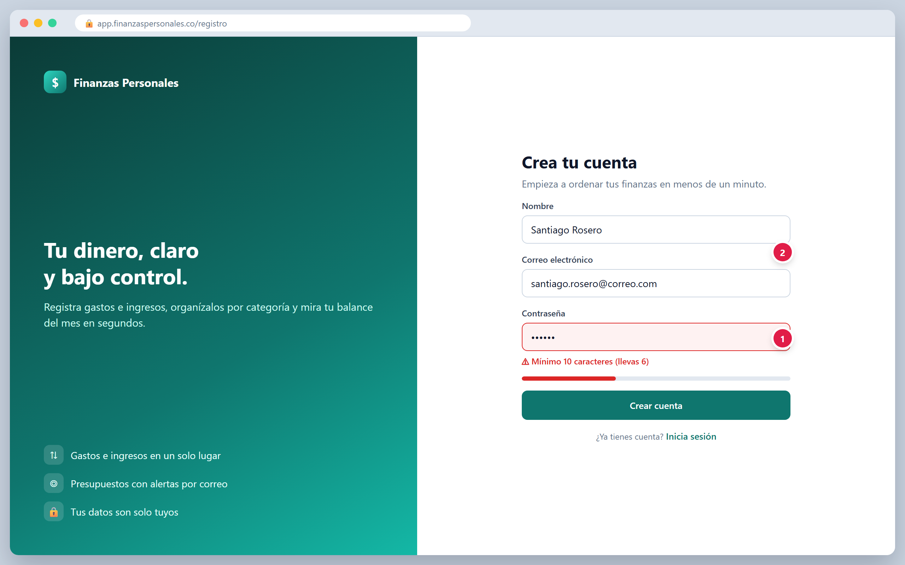

### HU-02 Iniciar sesión

**Criterios de aceptación** · RF-03, RF-04 · M · 3 puntos · Pantalla: Inicio de sesión

1. **Dado** credenciales correctas, **cuando** inicio sesión, **entonces** recibo un token de acceso válido por 15 minutos y una cookie de renovación `HttpOnly` válida por 7 días.
2. **Dado** credenciales incorrectas, **cuando** inicio sesión, **entonces** veo «Correo o contraseña incorrectos», sin indicar cuál de los dos falló.
3. **Dado** 5 intentos fallidos seguidos, **cuando** hago el sexto, **entonces** la cuenta queda bloqueada 15 minutos y se me informa.

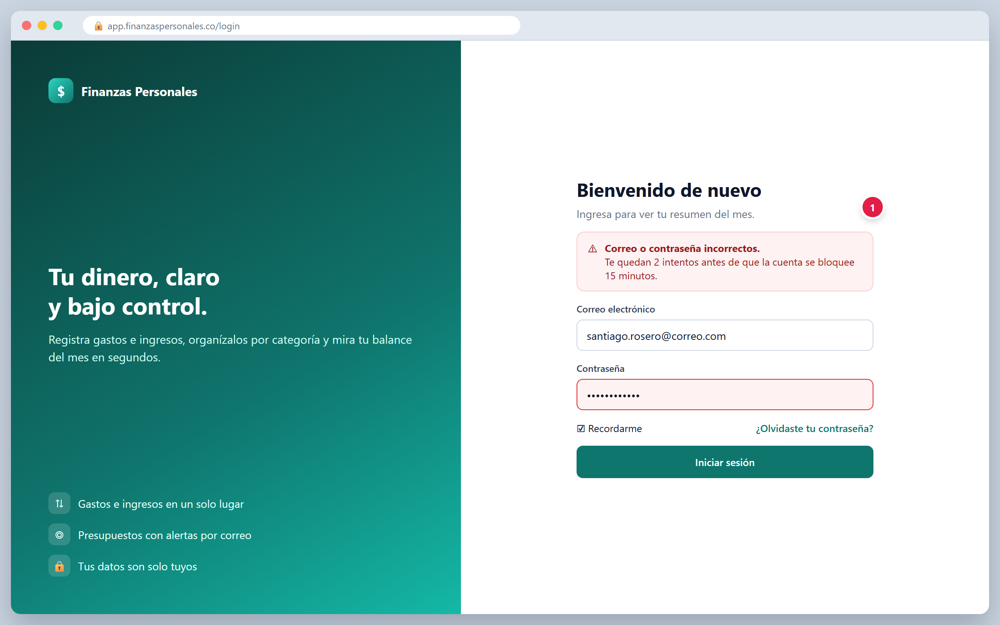

### HU-03 Mantener la sesión activa

**Criterios de aceptación** · RF-05 · S · 2 puntos · Pantalla: Movimientos (aviso de sesión renovada)

1. **Dado** un token de acceso vencido y una cookie de renovación válida, **cuando** el Cliente Web hace una petición, **entonces** obtiene un token nuevo y repite la petición sin que yo lo note.
2. **Dado** que la cookie de renovación venció o fue revocada, **entonces** se me lleva a iniciar sesión y se conserva lo que tenía escrito en el formulario.

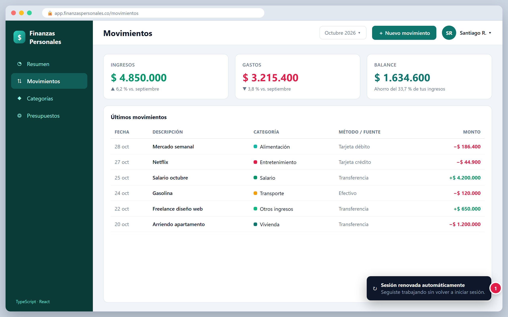

### HU-04 Cerrar sesión

**Criterios de aceptación** · RF-06 · M · 1 punto · Pantalla: Menú de usuario

1. **Cuando** cierro sesión, **entonces** el token de renovación queda revocado en el servidor y el Cliente Web borra los tokens locales.
2. **Dado** que cerré sesión, **cuando** intento usar el token anterior, **entonces** la API responde `401`.

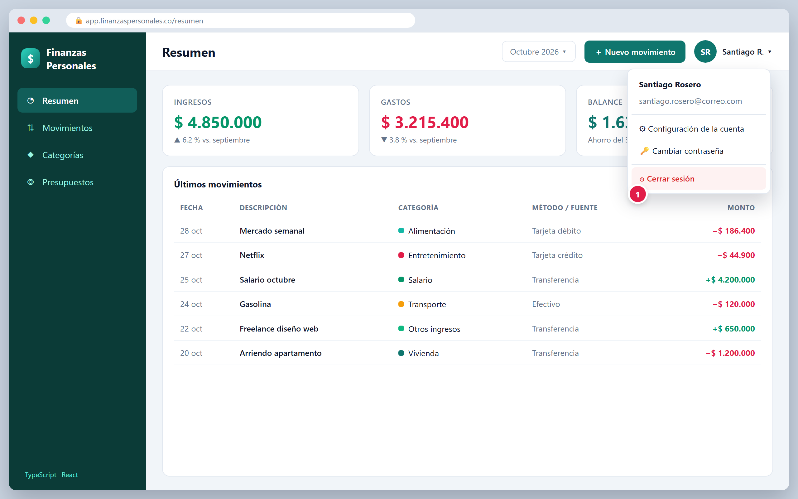

### HU-05 Recuperar mi contraseña

**Criterios de aceptación** · RF-07, RF-08 · S · 5 puntos · Pantalla: Recuperar contraseña

1. **Cuando** solicito la recuperación con mi correo, **entonces** recibo un enlace de un solo uso válido por 30 minutos.
2. **Dado** un correo que no existe, **cuando** solicito la recuperación, **entonces** veo el mismo mensaje que si existiera, para no revelar qué correos están registrados.
3. **Cuando** defino la nueva contraseña con un enlace válido, **entonces** se cierran todas mis sesiones abiertas y el enlace deja de servir.
4. **Dado** un enlace vencido o ya usado, **entonces** veo «El enlace no es válido» y puedo pedir otro.

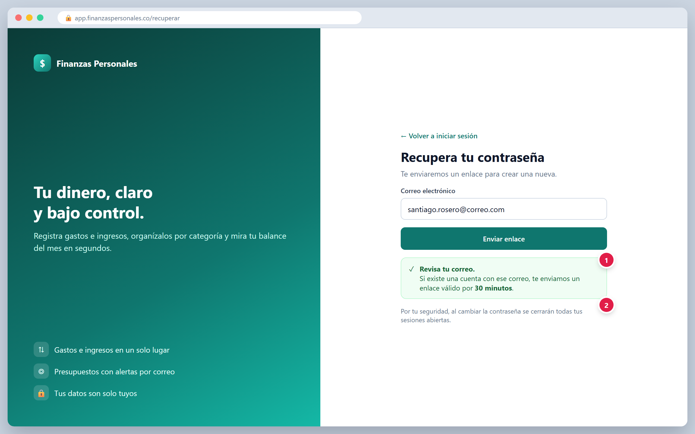

### HU-06 Registrar un gasto

**Criterios de aceptación** · RF-09, RF-11 · M · 5 puntos · Pantalla: Nuevo movimiento (gasto)

1. **Dado** que tengo sesión iniciada, **cuando** registro un gasto con monto mayor que 0, fecha no futura y una categoría de tipo GASTO, **entonces** se guarda y el saldo del mes se actualiza.
2. **Dado** un monto de 0, negativo o con más de 2 decimales, **entonces** el formulario marca el campo y no se guarda nada.
3. **Dado** una categoría de tipo INGRESO, **cuando** la elijo para un gasto, **entonces** la API responde `422` («La categoría no corresponde al tipo de movimiento»).
4. **Dado** una categoría de otro usuario, **entonces** la API responde `422` y no revela que esa categoría existe.

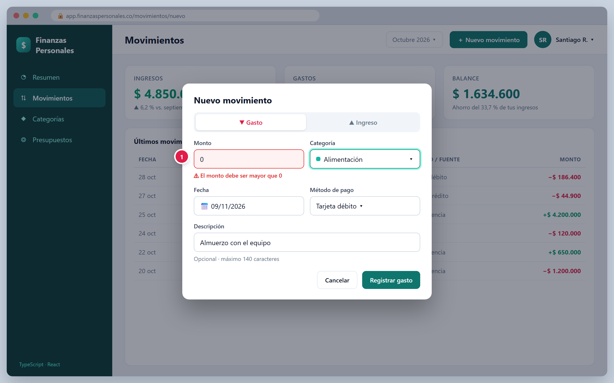

### HU-07 Registrar un ingreso

**Criterios de aceptación** · RF-10, RF-11 · M · 3 puntos · Pantalla: Nuevo movimiento (ingreso)

1. **Cuando** registro un ingreso válido con una categoría de tipo INGRESO, **entonces** se guarda y se suma al balance del mes.
2. Las validaciones de monto y fecha son las mismas de HU-06.

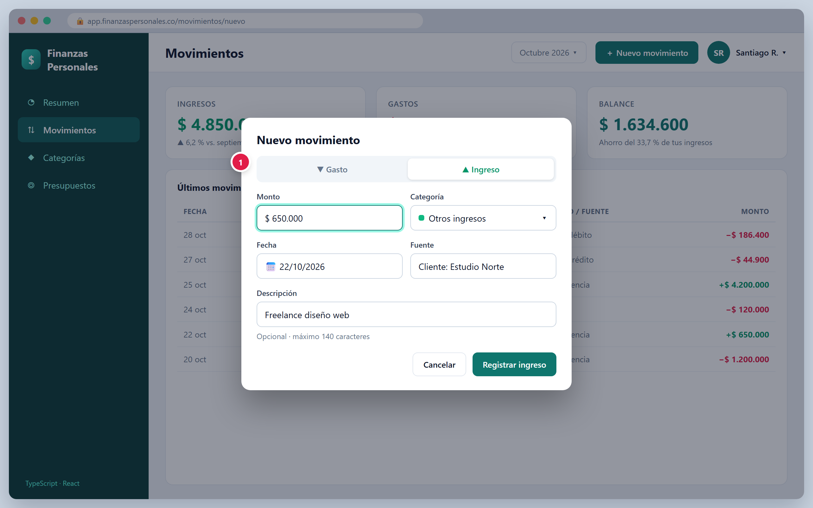

### HU-08 Modificar un movimiento

**Criterios de aceptación** · RF-11, RF-12 · S · 3 puntos · Pantalla: Editar movimiento

1. **Cuando** cambio monto, fecha, descripción o categoría de un movimiento propio, **entonces** se guardan los cambios y se vuelven a aplicar todas las reglas de registro.
2. **Dado** un movimiento de otro usuario, **cuando** intento modificarlo, **entonces** la API responde `404`.
3. Al cambiar la fecha o la categoría de un gasto, se recalcula el presupuesto afectado.

### HU-09 Eliminar un movimiento

**Criterios de aceptación** · RF-13 · S · 2 puntos · Pantalla: Eliminar movimiento (confirmación)

1. **Cuando** elimino un movimiento propio, **entonces** el Cliente Web pide confirmación y, tras confirmar, el movimiento desaparece del historial y de los totales.
2. **Dado** un movimiento de otro usuario, **entonces** la API responde `404`.

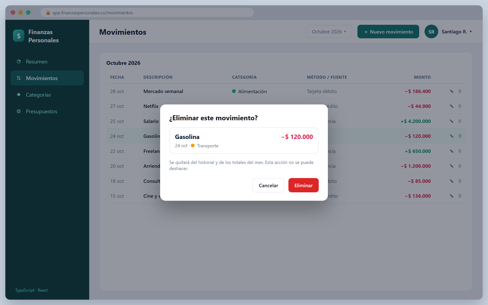

### HU-10 Usar categorías predeterminadas

**Criterios de aceptación** · RF-14 · M · 2 puntos · Pantalla: Categorías predeterminadas

1. **Cuando** registro un movimiento, **entonces** veo las categorías predeterminadas del tipo elegido y, además, las mías.
2. Las categorías predeterminadas no se pueden renombrar ni eliminar.

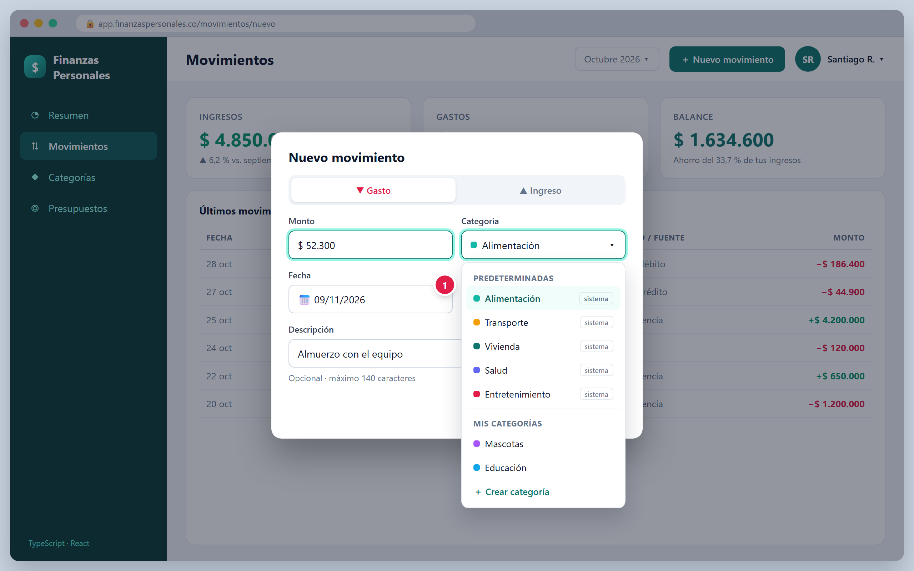

### HU-11 Crear y renombrar mis categorías

**Criterios de aceptación** · RF-15, RF-16 · S · 3 puntos · Pantalla: Categorías (crear y renombrar)

1. **Cuando** creo una categoría con nombre de 1 a 40 caracteres y un tipo (GASTO o INGRESO), **entonces** queda disponible solo para mí.
2. **Dado** que ya tengo una categoría con ese nombre y ese tipo, **entonces** veo «Ya existe una categoría con ese nombre» (`409`).

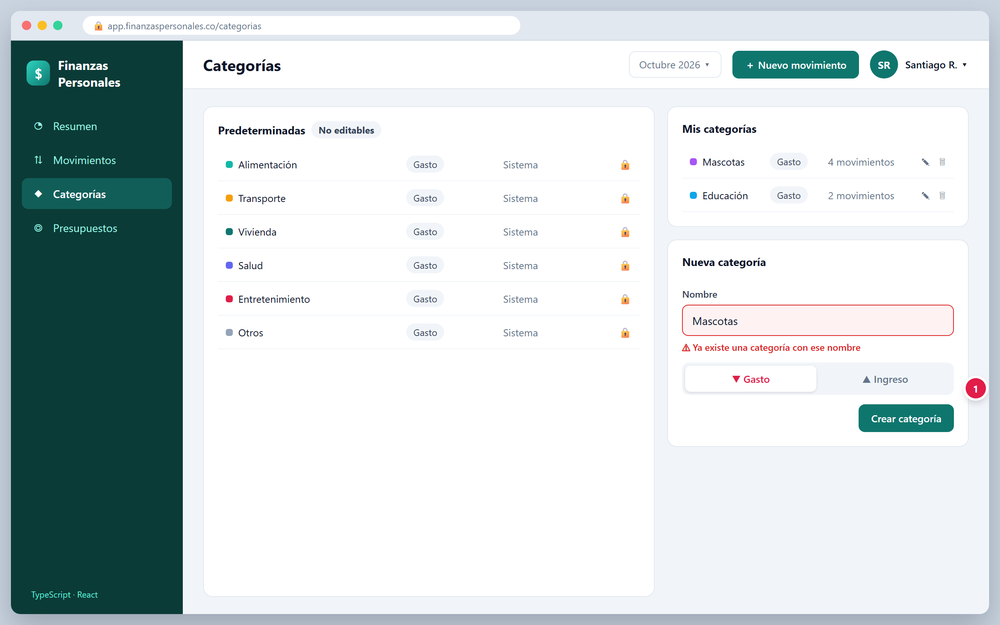

### HU-12 Eliminar una categoría propia

**Criterios de aceptación** · RF-17 · C · 3 puntos · Pantalla: Categorías (eliminar con reasignación)

1. **Dado** que la categoría tiene movimientos, **cuando** la elimino, **entonces** debo elegir una categoría destino del mismo tipo y todos sus movimientos se reasignan.
2. **Dado** que la categoría no tiene movimientos, **entonces** se elimina directamente.

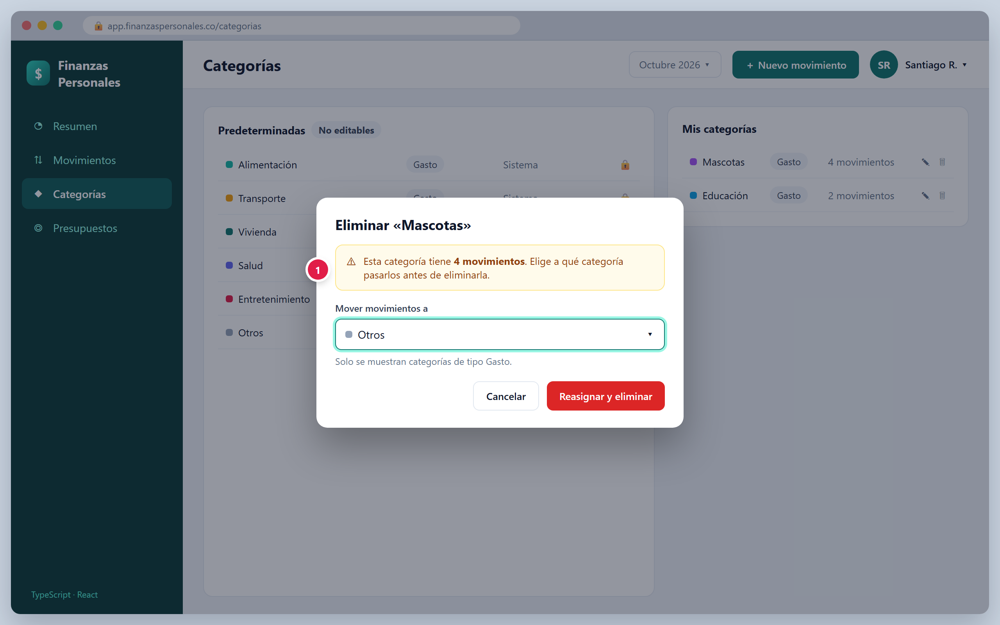

### HU-13 Definir un presupuesto mensual

**Criterios de aceptación** · RF-18 · S · 3 puntos · Pantalla: Presupuestos (definir límite)

1. **Cuando** defino un presupuesto con límite mayor que 0 para una categoría de tipo GASTO y un mes, **entonces** se guarda.
2. **Dado** que ya existe un presupuesto para esa categoría y ese mes, **entonces** se actualiza el límite en lugar de crear otro.
3. **Dado** una categoría de tipo INGRESO, **entonces** la API responde `422`.

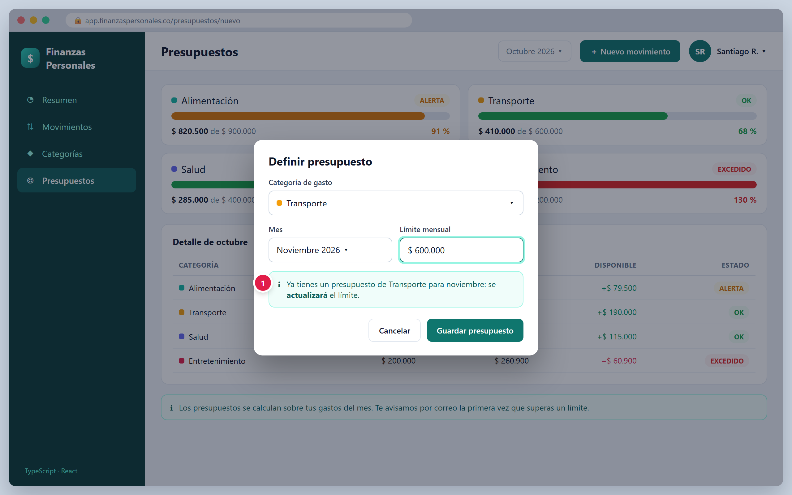

### HU-14 Ver el estado de mis presupuestos

**Criterios de aceptación** · RF-19 · S · 3 puntos · Pantalla: Presupuestos (estado del mes)

1. **Cuando** abro mis presupuestos de un mes, **entonces** veo para cada uno el límite, el consumo, el porcentaje y el estado: **OK** (menos del 80 %), **ALERTA** (80 % a 99 %) o **EXCEDIDO** (100 % o más).

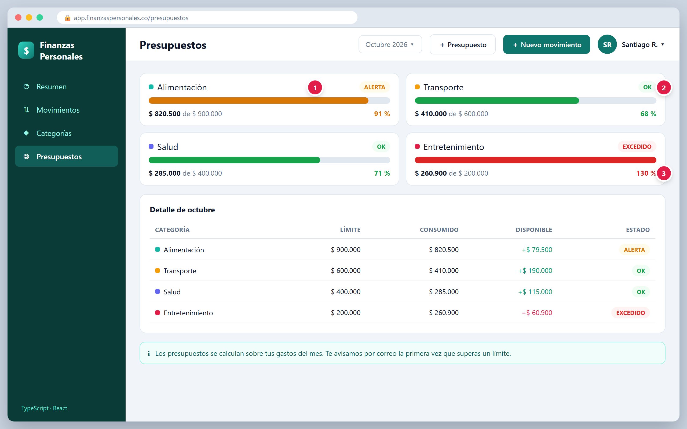

### HU-15 Recibir una alerta al exceder un presupuesto

**Criterios de aceptación** · RF-20 · C · 5 puntos · Pantalla: Correo de alerta de presupuesto

1. **Dado** un gasto que hace superar el límite por primera vez en el mes, **cuando** se guarda, **entonces** se envía un correo de alerta.
2. **Dado** que ya se envió la alerta ese mes, **cuando** registro otro gasto en la categoría, **entonces** no se envía otro correo.
3. **Dado** que el servicio de correo falla, **entonces** el gasto igual queda guardado y el envío se reintenta hasta 3 veces.

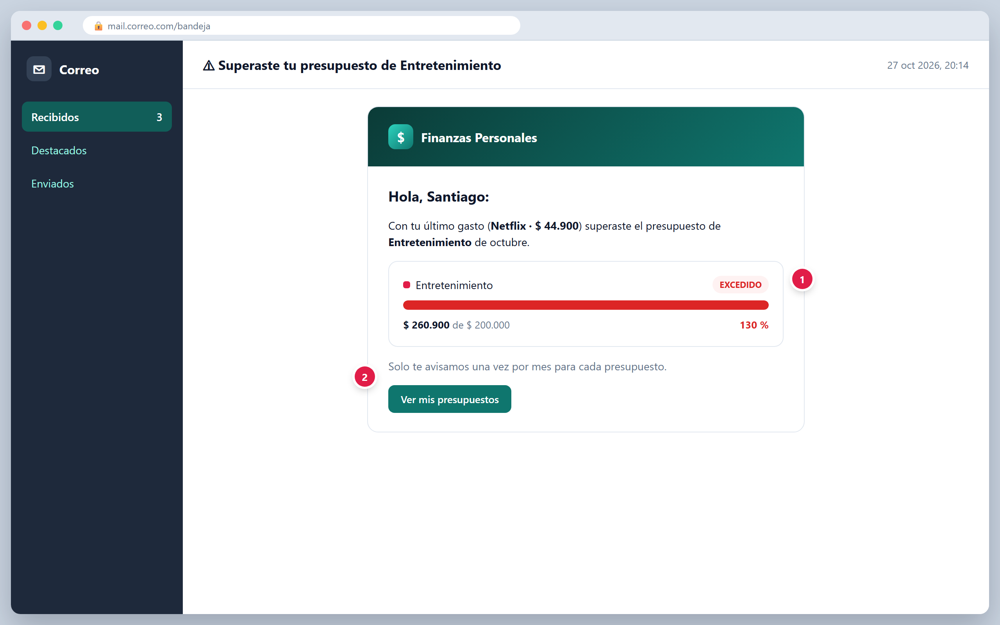

### HU-16 Consultar mi historial

**Criterios de aceptación** · RF-21 · M · 3 puntos · Pantalla: Historial

1. **Cuando** abro el historial, **entonces** veo los movimientos del mes actual en páginas de 20, ordenados por fecha descendente.
2. **Dado** que no hay movimientos, **entonces** veo «No hay movimientos para este filtro» y un acceso para registrar uno.

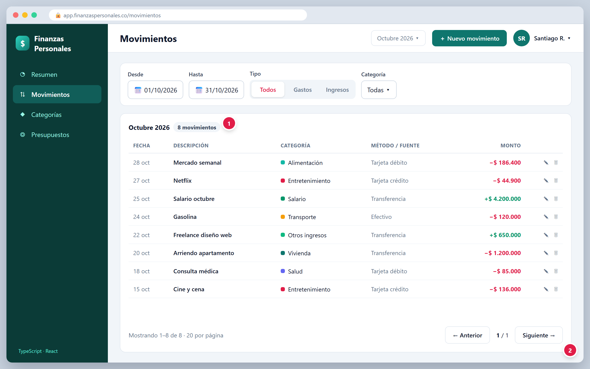

### HU-17 Filtrar el historial

**Criterios de aceptación** · RF-22 · S · 3 puntos · Pantalla: Historial con filtros

1. **Cuando** aplico un rango de fechas, un tipo o una categoría, **entonces** el historial y su total muestran solo los movimientos que cumplen el filtro.
2. **Dado** un rango en el que la fecha inicial es posterior a la final, o un rango mayor a 24 meses, **entonces** el filtro se rechaza con un mensaje claro.

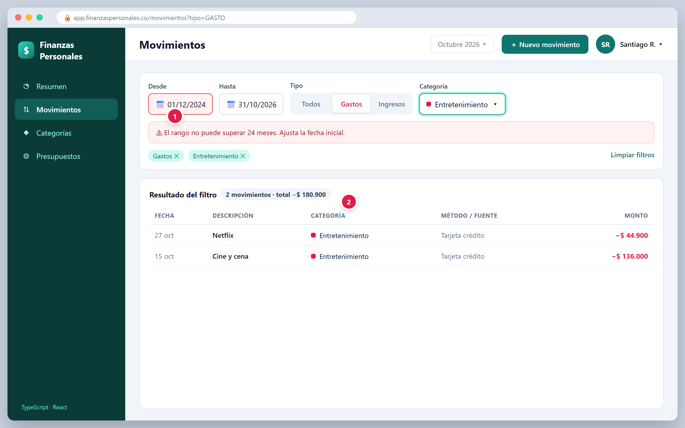

### HU-18 Ver mi resumen financiero

**Criterios de aceptación** · RF-23 · M · 5 puntos · Pantalla: Resumen financiero

1. **Cuando** abro el resumen de un período, **entonces** veo total de ingresos, total de gastos y balance (ingresos − gastos).
2. Los montos se calculan con precisión decimal exacta (`BigDecimal` en Java, `NUMERIC(14,2)` en la base de datos).

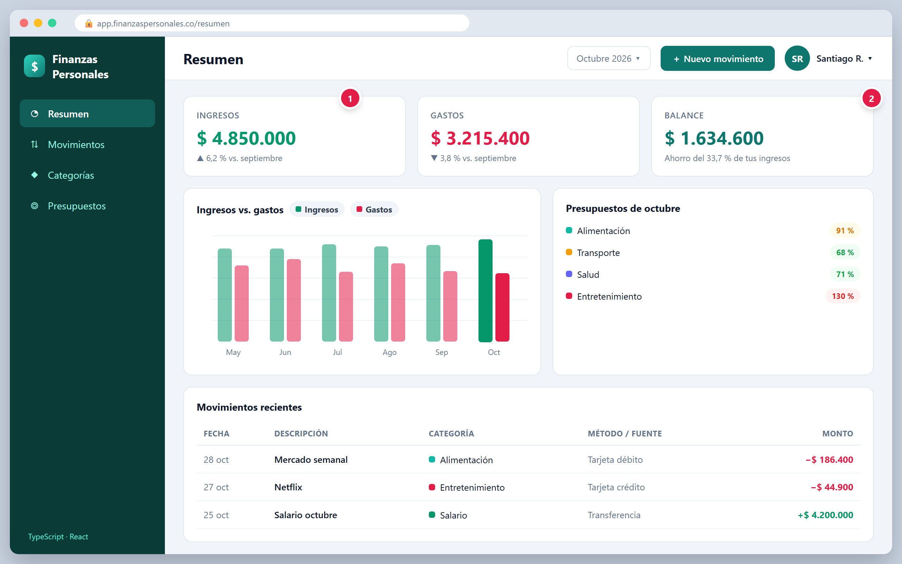

### HU-19 Ver el gasto por categoría

**Criterios de aceptación** · RF-24 · S · 3 puntos · Pantalla: Resumen (gasto por categoría)

1. **Cuando** abro el resumen, **entonces** veo una lista y un gráfico con el total y el porcentaje de cada categoría de gasto, de mayor a menor.
2. Los porcentajes suman 100 %, con un margen de redondeo de ±0,1 %.

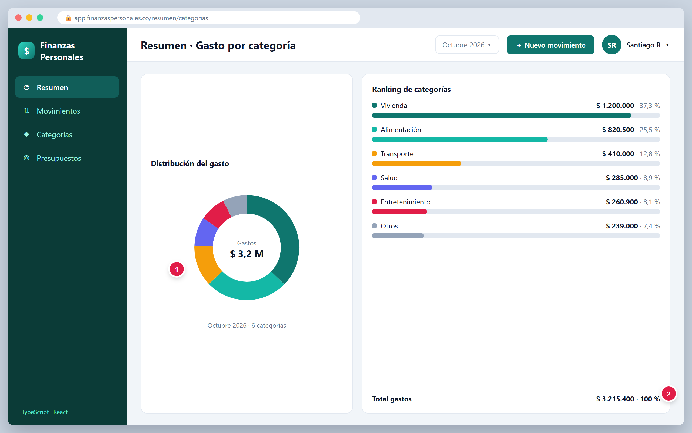

### HU-20 Eliminar mi cuenta

**Criterios de aceptación** · RF-25 · M · 3 puntos · Pantalla: Configuración de la cuenta (`/cuenta`), zona de peligro

1. **Dado** que estoy en *Configuración de la cuenta*, **cuando** pulso *Eliminar mi cuenta*, **entonces** veo un diálogo que explica las consecuencias y que la acción no se puede deshacer.
2. **Dado** el diálogo abierto, **cuando** pulso *Cancelar*, **entonces** no cambia nada.
3. **Dado** el diálogo abierto, **cuando** confirmo, **entonces** la cuenta pasa a `ELIMINADA` con `eliminadaEn`, se revocan todas mis sesiones y vuelvo al inicio de sesión con el aviso «Tu cuenta fue eliminada».
4. **Dado** una cuenta eliminada, **cuando** intento iniciar sesión con su correo, **entonces** recibo el mismo mensaje que con credenciales incorrectas.

Mockup: (1) botón «Eliminar mi cuenta» en la zona de peligro, (2) diálogo de confirmación, (3) aviso de que se vuelve al inicio de sesión.

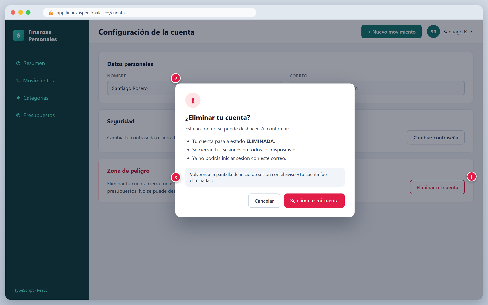

### HU-21 Actualizar mis datos personales

**Criterios de aceptación** · RF-26 · S · 2 puntos · Pantalla: Configuración de la cuenta, datos personales

1. **Dado** que abro *Configuración de la cuenta*, **entonces** veo mi nombre, mi correo y la fecha de registro.
2. **Dado** un nombre de 2 a 80 caracteres, **cuando** pulso *Guardar cambios*, **entonces** se guarda, veo «Datos actualizados» y el nombre cambia en el encabezado.
3. **Dado** un nombre vacío o de más de 80 caracteres, **cuando** intento guardar, **entonces** el Cliente Web lo rechaza e indica el límite.
4. El correo se muestra pero no se puede editar, porque es el identificador de inicio de sesión (RN-06).

Mockup: (1) nombre editable con contador, (2) correo bloqueado con su explicación, (3) aviso «Datos actualizados».

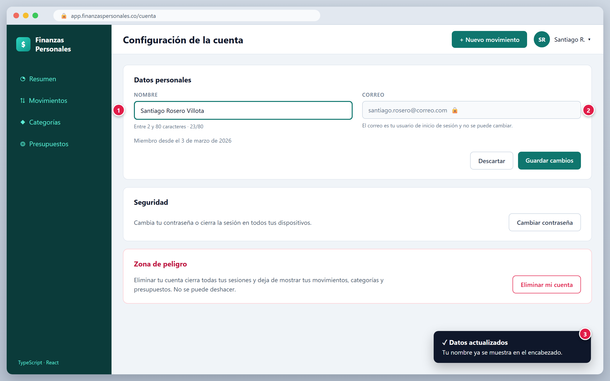

### HU-22 Cambiar mi contraseña

**Criterios de aceptación** · RF-27 · S · 3 puntos · Pantalla: Configuración de la cuenta, seguridad

1. **Dado** la contraseña actual correcta y una nueva de al menos 10 caracteres distinta de la actual, **cuando** confirmo, **entonces** se guarda con BCrypt (RN-07) y veo «Contraseña actualizada».
2. **Dado** una contraseña actual incorrecta, **cuando** confirmo, **entonces** veo «La contraseña actual no es correcta» y no cambia nada.
3. **Dado** que la nueva y su confirmación no coinciden, **entonces** el Cliente Web lo indica antes de llamar a la API.
4. Al cambiarla, se revocan las sesiones de los demás dispositivos; la sesión actual sigue activa.

Mockup: (1) contraseña actual, (2) validación en vivo de la nueva, (3) aviso de cierre de otras sesiones, (4) confirmación.

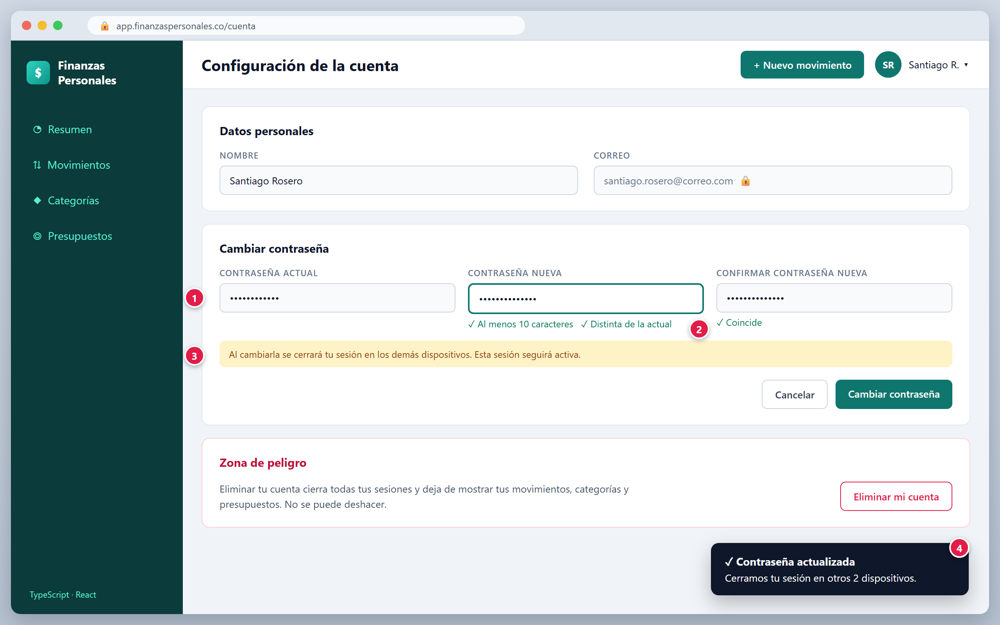
