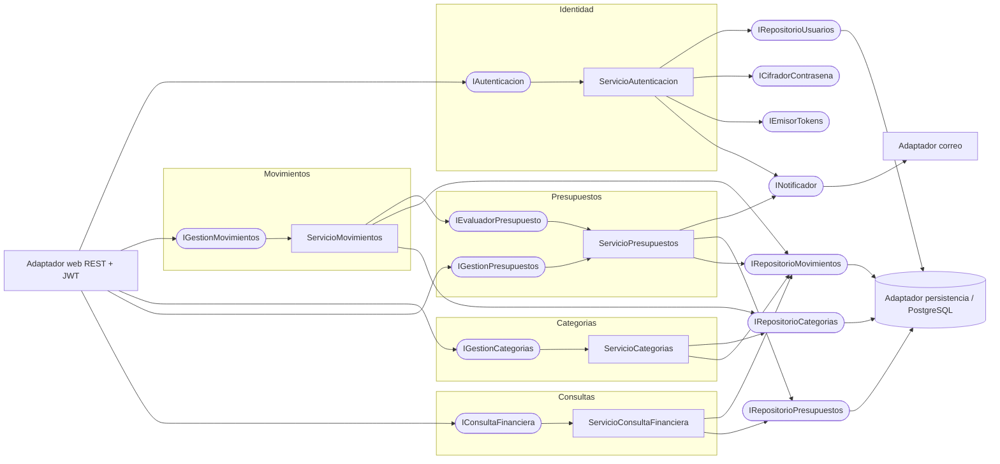
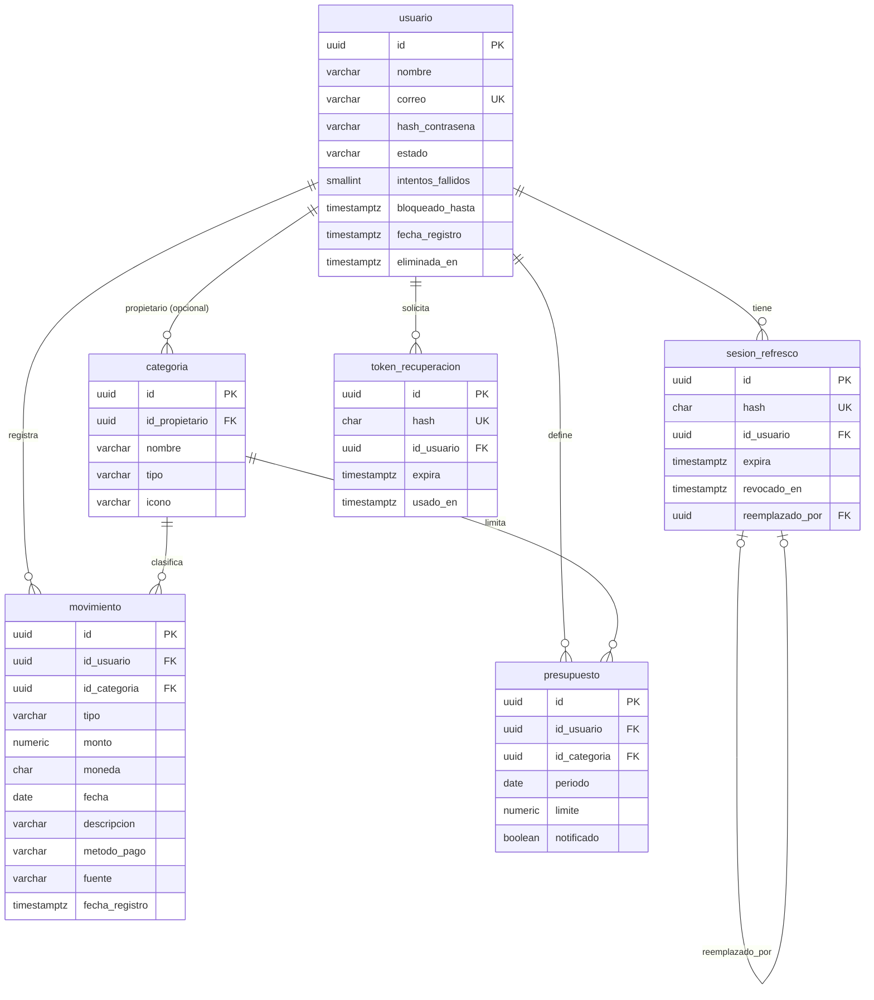

# Arquitectura objetivo — Finanzas Personales (PROPUESTA, no original)

> **Histórico (fase de diseño, 09-11-2026).** Esta propuesta usaba PostgreSQL, JDBC y Flyway. La aplicación se implementó con **MongoDB** ([ADR-004](ADR-004-mongodb.md)).
>
> La arquitectura vigente, alineada con el código, está en:
> - [docs/arquitectura/](../arquitectura/) (vistas 4+1, con el modelo de datos en `vista-logica.md` §4);
> - `modelo/Finanzas_Personales_5_diagramas.vpp`.
>
> Este documento se conserva para trazar las decisiones de diseño; no lo uses como descripción del sistema actual.

Rama `ai/redesign` · 2026-11-09 · Resuelve P-04..P-07, P-12, P-14..P-20 de `docs/diagnostico/diagnostico.md`. No modifica los originales.

## 1. Alcance y supuestos
| Tema | Decisión |
|---|---|
| Dentro | Arquitectura lógica y de datos, diagramas Mermaid, DDL de referencia, pruebas SQL del esquema |
| Fuera | Backend Java/Spring, frontend, despliegue, tecnologías o dependencias nuevas |
| Moneda (supuesto) | Solo COP: `moneda CHAR(3) DEFAULT 'COP' CHECK (moneda='COP')`. `Dinero` conserva el campo |
| Se mantienen | ADR-001 (monolito modular), ADR-002 (hexagonal), ADR-003 (PostgreSQL 16), JWT |
| Pruebas | Se ejecutan en PostgreSQL 18 local, sin sintaxis exclusiva de la 18. Compatibilidad con la 16: **NO VERIFICADO** |

## 2. Módulos y puertos

El módulo Notificaciones es el puerto `INotificador` junto con su adaptador de correo.

**P-12: firmas canónicas.** Se usan las de LOG-02 y SEQ-01..03 se redibujan con ellas.
| Operación | Firma canónica | Firma descartada (SEQ) |
|---|---|---|
| `enviarAlertaPresupuesto` | `(correo: Email, p: PresupuestoDTO)` | `(usuario, presupuesto)` |
| `obtenerResumen` | `(idUsuario, desde: LocalDate, hasta: LocalDate)` | `(idUsuario, periodo)` |
| `sumarPorCategoria` | `(idUsuario, desde, hasta): List<TotalPorCategoria>` | `(idUsuario, periodo)` |

Motivo: RN-13 define los rangos como `desde..hasta` y el notificador solo necesita el correo. `CategoriaNoDisponibleException` se añade a LOG como excepción de aplicación y se devuelve como HTTP 422.

**P-14:**
- `IConsultaFinanciera.obtenerMovimiento` **se mantiene** (D-3b rechazada). Lo usa CU-07 paso 4, "abre un movimiento (→ CU-04)" (`VISTA_FUNCIONAL.md:82`), y permite recargar la página o abrir un enlace directo. Falta un RF y su interfaz `GET /api/v1/movimientos/{id}`, que quedan como pendientes.
- `IGestionPresupuestos.eliminar` **se elimina** (D-3a aprobada). No hay RF, HU ni interfaz `DELETE` que lo usen (`REQUERIMIENTOS_FUNCIONALES.md:202,210`). Para desactivar un presupuesto se redefine con `definir`.

## 3. Contratos (puertos de entrada)
| Puerto | Operaciones | RF / CU |
|---|---|---|
| IAutenticacion | `registrar`, `iniciarSesion` (bloqueo RN-08), `renovarSesion`, `cerrarSesion`, `solicitarRecuperacion`, `restablecerContrasena` | RF-01..08 / CU-01, CU-02, CU-09 |
| IGestionMovimientos | `registrarGasto`, `registrarIngreso`, `modificar`, `eliminar` | RF-09..13 / CU-03, CU-04 |
| IGestionCategorias | `listarDisponibles`, `crear`, `renombrar`, `eliminar(destino)` | RF-14..17 / CU-05 |
| IGestionPresupuestos | `definir` (upsert), `listar` | RF-18, RF-19 / CU-06 |
| IEvaluadorPresupuesto | `evaluar(gasto)`; también se llama desde `modificar` y `eliminar` | RF-12, RF-20 / CU-10 (RN-11, RN-12) |
| IConsultaFinanciera | `consultarHistorial`, `obtenerMovimiento`, `obtenerResumen` | RF-21..24 / CU-07, CU-08, CU-11 (RN-13); `obtenerMovimiento` sin RF (pendiente) |

Puertos de salida: los de LOG-02, con `sumarPorCategoria` según la firma de §2.

**Concurrencia (P-19):**
- `definir` hace `INSERT … ON CONFLICT (id_usuario,id_categoria,periodo) DO UPDATE SET limite=…, notificado=false`.
- La alerta se reclama con `UPDATE presupuesto SET notificado=true WHERE id=? AND NOT notificado`.
- Solo si ese `UPDATE` afecta 1 fila se llama a `INotificador`.

## 4. Datos

Todas las FK se nombran `id_<entidad>` (P-25). La herencia Gasto/Ingreso se guarda en una sola tabla `movimiento` con discriminador `tipo`.

| Regla | Mecanismo SQL |
|---|---|
| RN-01 | `monto NUMERIC(14,2) CHECK (monto>0 AND monto<=999999999999.99)`. La regla de **máximo 2 decimales** se valida en el dominio: `NUMERIC(14,2)` redondea en silencio (10.555 → 10.56; revisión R-01, ejecutado) |
| RN-03 | `UNIQUE(id,tipo)` en categoria; FK compuesta `movimiento(id_categoria,tipo) → categoria(id,tipo)` |
| RN-04 | Trigger `BEFORE INSERT/UPDATE` en movimiento y presupuesto: exige `categoria.id_propietario IS NULL OR = id_usuario`. Otro trigger impide cambiar `categoria.id_propietario` |
| RN-06 | `UNIQUE(correo)`, `CHECK (correo=lower(correo))` |
| RN-09 | `CHECK (char_length(nombre) BETWEEN 1 AND 40)`. Índices únicos parciales `(id_propietario,tipo,lower(nombre)) WHERE id_propietario IS NOT NULL` y `(tipo,lower(nombre)) WHERE id_propietario IS NULL` |
| **RN-14 (PROPUESTA)** | Una categoría propia no puede repetir nombre normalizado (`lower(btrim(nombre))`) y tipo de una predeterminada, ni al revés. Se implementa con el trigger `fn_categoria_nombre_unico_global` + `pg_advisory_xact_lock`, que lanza `unique_violation`. Origen: revisión R-09, decisión del usuario del 2026-11-09 |
| RN-10 | `tipo_categoria DEFAULT 'GASTO' CHECK (='GASTO')` + FK compuesta a `categoria(id,tipo)`; `UNIQUE(id_usuario,id_categoria,periodo)`; `CHECK (periodo = date_trunc('month',periodo))` |
| RN-12 | Columna `notificado` + `UPDATE` atómico (§3) |
| Gasto/Ingreso | `CHECK ((tipo='GASTO' AND metodo_pago IS NOT NULL AND fuente IS NULL) OR (tipo='INGRESO' AND metodo_pago IS NULL))`. Se escribe explícito para no repetir el error NULL/IN de P-22 |

**P-07: borrado lógico de usuario.**
- El usuario no se borra físicamente: pasa a `estado = ELIMINADA` y se registra `eliminada_en TIMESTAMPTZ`.
- La eliminación de la cuenta la piden HU-20 y RF-25 (propuestos, `docs/08-requisitos/configuracion/`). Purga física: **pendiente**.
- La Ley 1581/2012 (habeas data, Colombia) exige un derecho de supresión, que RNF-14 cubre con RF-25; el alcance legal exacto es **NO VERIFICADO**. También queda pendiente su relación con la retención de respaldos de 30 días (`VISTA_DESPLIEGUE.md:16`).
- Todas las FK usan `ON DELETE RESTRICT`. Se descarta el CASCADE original porque contradice el estado ELIMINADA.
- El usuario puede borrar físicamente sus movimientos y presupuestos.
- Una categoría solo se borra después de reasignar sus movimientos.

**P-18: bloqueo.** El valor BLOQUEADA sale de `estado` en BD. Una cuenta está bloqueada mientras `bloqueado_hasta > now()`, y se añade `CHECK (intentos_fallidos BETWEEN 0 AND 5)`.

**P-16: sesiones.** `sesion_refresco` guarda el hash, `revocado_en` y `reemplazado_por`. Si alguien reutiliza un token ya reemplazado, se revoca toda la cadena (RF-05).

**P-20: índices.**
1. `movimiento(id_usuario, fecha DESC, id DESC)`: historial.
2. `movimiento(id_usuario, id_categoria, fecha) INCLUDE (monto)`: `SUM` por categoría.
3. `movimiento(id_categoria, tipo)`: FK y reasignación.
4. `presupuesto(id_usuario, periodo)`.
5. Los únicos parciales de categoría.
6. `sesion_refresco(id_usuario)` y `token_recuperacion(id_usuario)`.
7. Índices sobre FK que no tenían uno (revisión R-05): `presupuesto(id_categoria)`, `categoria(id_propietario)`, `sesion_refresco(reemplazado_por)`.

## 5. Seguridad
| Tema | Medida |
|---|---|
| RNF-01 | Sin cambios: BCrypt 12, JWT RS256 de 15 min, refresh rotativo en cookie `HttpOnly; Secure; SameSite=Strict`, CORS restringido. En BD solo se guardan hashes de los tokens. El token de recuperación caduca y es de un solo uso |
| RNF-02 / RN-05 | `idUsuario` sale solo de `token.sub`. Todo repositorio recibe `idUsuario` y filtra con `WHERE id=? AND id_usuario=?`. Un recurso de otro usuario responde 404 |
| RN-04 (P-04) | El trigger de BD es una segunda barrera: no sustituye el filtro de la aplicación |
| RLS | No se adopta: exigiría fijar el usuario en la sesión de BD, y eso cambia la arquitectura |
| RN-02 | Se valida solo en el dominio, porque un `CHECK` no puede usar `now()` (no es inmutable) |

## 6. Plan de pruebas del esquema
Las pruebas son SQL sobre PostgreSQL 18. Cada caso corre en una transacción con `ROLLBACK` y su salida va a `docs/evidencias/pruebas/*.log`.
| ID | Regla | Caso | Esperado |
|---|---|---|---|
| T-01 | RN-01 | Monto 0, negativo y 1 000 000 000 000 | `check_violation` (0 y negativo); `numeric_value_out_of_range` 22003 (10¹²)* |
| T-02 | RN-01 | Monto 999999999999.99 | OK |
| T-03 | RN-03 | Gasto con categoría de tipo INGRESO | `foreign_key_violation` |
| T-04 | RN-04 | Movimiento de A con categoría propia de B | Excepción del trigger |
| T-05 | RN-04 | Movimiento con categoría predeterminada | OK |
| T-06 | RN-06 | Correo con mayúsculas; correo duplicado | `check_violation`; `unique_violation` |
| T-07 | RN-09 | Nombre de 0 caracteres y de 41 | `check_violation` (0); `string_data_right_truncation` 22001 (41)* |
| T-08 | RN-09 | Dos predeterminadas "Comida" y "comida" | `unique_violation` |
| T-09 | RN-09 | Mismo nombre dos veces en el mismo usuario / en otro usuario | `unique_violation` / OK |
| T-10 | RN-10 | Presupuesto sobre categoría INGRESO; duplicado; periodo que no empieza el día 1 | FK / unique / check |
| T-11 | Gasto/Ingreso | Gasto sin `metodo_pago`; ingreso con `metodo_pago` | `check_violation` |
| T-12 | P-07 | `DELETE` de un usuario con movimientos | `restrict_violation` 23001* (es el código que da `ON DELETE RESTRICT`; `foreign_key_violation` 23503 corresponde a `NO ACTION`) |
| T-13 | Moneda | `moneda='USD'` | `check_violation` |
| T-14 | P-16 | `reemplazado_por` apunta a una sesión inexistente | `foreign_key_violation` |
| T-15 | P-19 | `ON CONFLICT` y luego un segundo `UPDATE … WHERE NOT notificado` | El segundo `UPDATE` afecta 0 filas |
| T-16 | P-20 | `EXPLAIN` del historial y de la suma por categoría | Usa los índices 1 y 2 (informativo, depende del planificador). Observación de la 1.ª ejecución: la suma usó el índice del historial |
| T-17 | RN-14 (PROPUESTA) | Categoría propia con el nombre de una predeterminada (variando mayúsculas y espacios); predeterminada nueva con el nombre de una propia; mismo nombre con otro tipo | `unique_violation`; `unique_violation`; OK |

\* **Expectativa corregida después de ejecutar** (1.ª ejecución: `F5_tests_esquema.log`, 3 FAIL). Se corrigió lo que esperaba la prueba, no el esquema: el dato inválido ya se rechazaba, solo que con otro código de error.

Fuera de alcance: lógica Java, JWT, BCrypt, envío de correo, RN-02, RN-05 en la capa web, rendimiento y PostgreSQL 16 (**NO VERIFICADO**).

## 7. Decisiones (resueltas por el usuario el 2026-11-09)
| # | Decisión | Estado |
|---|---|---|
| D-1 | Borrado lógico de usuario (`ELIMINADA` + `eliminada_en`) y `ON DELETE RESTRICT`; purga física pendiente | APROBADA |
| D-2 | Firmas canónicas de P-12 (se alinean SEQ y LOG-02) | APROBADA |
| D-3a | Eliminar `IGestionPresupuestos.eliminar` | APROBADA |
| D-3b | Eliminar `IConsultaFinanciera.obtenerMovimiento` | **RECHAZADA**: se mantiene |
| D-4 | `BLOQUEADA` se deriva de `bloqueado_hasta` en lugar de guardarse en `estado` | APROBADA |
| D-5 | Trigger PL/pgSQL para RN-04 | APROBADA |
| D-6 | `sesion_refresco` con `reemplazado_por` y `revocado_en` | APROBADA |
| D-7 | `token_recuperacion.usado_en` (timestamp) | APROBADA |
| D-8 | Moneda única COP | APROBADA (supuesto) |
| D-9 | No adoptar RLS | APROBADA |
