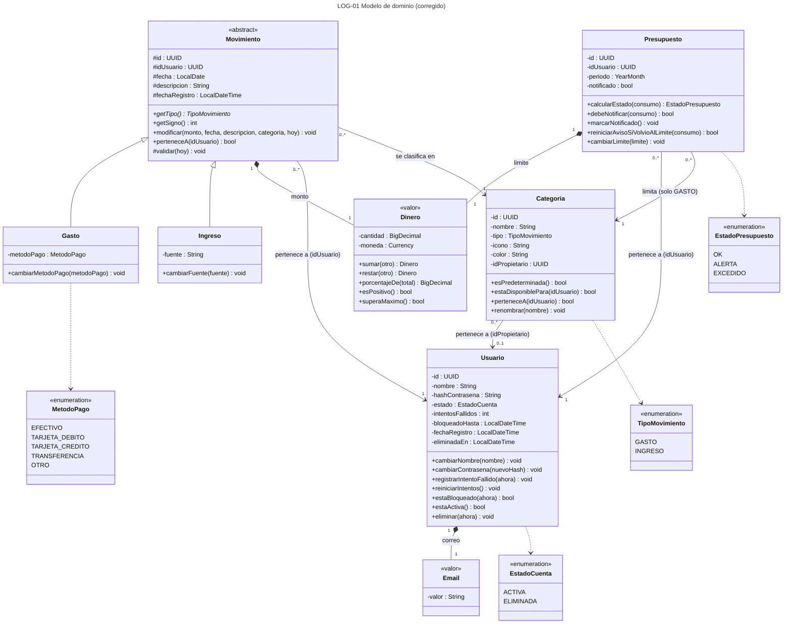
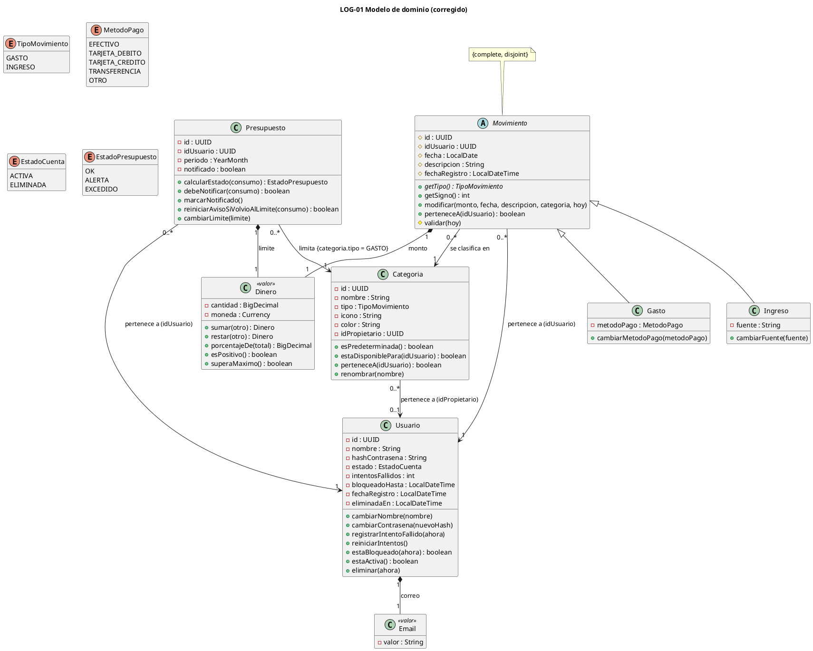

# Correcciones de los diagramas de Visual Paradigm

Revisé `modelo/Finanzas_Personales_5_diagramas.vpp`, con sus 7 diagramas exportados en `docs/evidencias/diagramas/vp/`. Para leerlo usé el XML que genera la herramienta `ExportXML` de Visual Paradigm 18.1. Comparé cada clase, atributo, operación y relación con el código de `backend/src/main/java/co/finanzas/**` y `frontend/src/**`.

## Errores encontrados y su corrección

| # | Diagrama | Error | Corrección | Estado |
|---|---|---|---|---|
| 1 | LOG-01 Modelo de dominio | `Usuario` tiene el atributo `bloqueada : boolean`, que no existe en `Usuario.java`. El bloqueo se calcula con `bloqueadoHasta` y `estaBloqueado(ahora)` (RN-08: 5 intentos fallidos, 15 minutos) | Quitar `bloqueada`. Se mantienen `bloqueadoHasta` y `+estaBloqueado(ahora) bool` | **Corregido en el `.vpp`**, en el Mermaid y en el PlantUML |
| 2 | LOG-01 | Faltan operaciones públicas que sí existen en el código: `Gasto.cambiarMetodoPago()`, `Ingreso.cambiarFuente()`, `Presupuesto.reiniciarAvisoSiVolvioAlLimite()`, `Categoria.perteneceA()`, `Usuario.estaActiva()` y `Dinero.superaMaximo()` | Añadirlas. Los *getters* no se dibujan, por convención | **Corregido en el `.vpp`**, en el Mermaid y en el PlantUML |
| 3 | LOG-01 | Las entidades no muestran su identificador `id : UUID`, aunque todas lo tienen | Añadir `id : UUID` a las 4 entidades, además de `idUsuario` en `Movimiento` y `Presupuesto` e `idPropietario` en `Categoria` | **Corregido en el `.vpp`**, en el Mermaid y en el PlantUML |
| 4 | LOG-01 | La navegabilidad está invertida. Se dibuja `Usuario → Movimiento`, `Usuario → Presupuesto` y `Usuario → Categoria`, pero `Usuario` no tiene listas de ellos. Es al revés: cada uno guarda el UUID de su dueño (`idUsuario`, o `idPropietario` en el caso de `Categoria`) | Asociación dirigida hacia `Usuario` y renombrada a "pertenece a (idUsuario)" o "pertenece a (idPropietario)", con multiplicidad `0..*` del lado del hijo y `1` del lado de `Usuario` (en `Categoria`, `0..1`, porque las predeterminadas no tienen dueño). Es asociación y no composición, porque el hijo no se guarda dentro de `Usuario` | **Corregido en el `.vpp`**, en el Mermaid y en el PlantUML |
| 5 | CTX-01 Contexto | Aparecía la entidad externa "Almacenamiento de respaldos (pg_dump)", que el código no implementa | Eliminada. El correo quedó como "SMTP con STARTTLS, opcional" | Ya corregido en el `.vpp` (commits 72f6a7a y 8589719) |
| 6 | FUN-01 Componentes | Usaba PostgreSQL y JDBC `:5432`, y las interfaces tenían nombres genéricos | MongoDB `:27017`, con interfaces nombradas como los puertos reales (`IGestionMovimientos`, `IRepositorioCategorias`, `INotificador`…) | Ya corregido en el `.vpp` |
| 7 | DEP-01 y DEP-02 Despliegue | Tenía nodos que no existen (PostgreSQL, Docker Compose, nginx, máquinas virtuales) y le faltaban protocolos y puertos | Usa nodos reales (Navegador, Vite, JVM, MongoDB, Vercel, Render, Atlas), con el protocolo y el puerto en cada conexión | Ya corregido en el `.vpp` |
| 8 | DEV-01 Desarrollo | Tenía unas 100 clases con todos sus atributos y no se podía leer en clase | Ahora es la vista por capas Controller → Service → Repository → Modelo. El detalle pasó al anexo DEV-02 | Ya corregido en el `.vpp` |
| 9 | LOG-01 | A `Categoria` le faltaba el atributo `color`, que existe en `Categoria.java` | Añadido `-color : String` | Ya corregido en el `.vpp` |
| 11 | FUN-01 Componentes funcionales | Faltaban 3 interfaces requeridas que `ConfiguracionServicios.java` sí inyecta: `Categorías → IRepositorioPresupuestos`, `Presupuestos → IRepositorioCategorias` y `Presupuestos → IRepositorioUsuarios` | Se añadieron las 3 dependencias de uso | **Corregido en el `.vpp`** |
| 12 | FUN-01 | Cada línea llevaba códigos RF/HU que se cruzaban y no dejaban leer el diagrama. Además, la API se marcaba como "HTTPS", pero en local usa HTTP | Se quitaron los códigos (la trazabilidad está en `docs/06-trazabilidad`) y la etiqueta queda "HTTP + JSON" | **Corregido en el `.vpp`** |
| 13 | DEP-01 y DEP-02 Despliegue | Tenían demasiado texto: 44 valores etiquetados, la palabra del protocolo repetida junto a su estereotipo (`«HTTP» HTTP`) y, en DEP-01, Postman y Compass, que son herramientas de prueba y no parte del sistema | Se quitaron los valores etiquetados, el texto repetido y las herramientas de prueba. Quedan nodos, artefactos, protocolo y puerto | **Corregido en ambos `.vpp`** |
| 14 | DEP-02 | Las conexiones a Atlas y a SMTP no tenían puerto | `Protocolo MongoDB sobre TLS · 27017` y `STARTTLS · 587` | **Corregido en el `.vpp`** (los puertos son los estándar, ver Supuestos) |
| 15 | LOG-01 y DEV-02 | El triángulo de herencia salía relleno, y UML lo dibuja hueco. La asociación con `Email` decía "tiene correos", pero la multiplicidad es 1 | Triángulo blanco y "tiene correo" | **Corregido en el `.vpp`** |
| 16 | DEV-02 Detalle de clases | Faltaban 33 clases y módulos que existen en el código: • **base de datos:** los 6 `*Documento` y los 6 `*RepositorioMongo`; • **backend:** `CookieSesion`, `FinanzasApplication`, `PuntoTendencia`, `TotalDiario` y `Validaciones`; • **frontend:** `ReportesPage`, `PantallaAcceso`, `ContextoMovimientos`, 8 componentes (`Plantilla`, `Graficos`…) y 5 módulos (`formato`, `validacion`, `tipos`…) | Añadidas en su paquete real. Los documentos muestran sus campos | **Corregido en el `.vpp`** |
| 17 | DEV-02 y DEV-01 | `MovimientosApi` tenía `registrarGasto()` y `registrarIngreso()`, pero `MovimientosApi.ts` tiene un solo `registrar(cmd)`. `ClienteHttp` tenía `renovarYReintentar()`, que no existe, y le faltaban `post`, `put`, `patch` y `delete` | Las operaciones son ahora las de `frontend/src/api/*.ts` | **Corregido en el `.vpp`** |
| 18 | DEV-01 Capas | Solo mostraba el backend: no se veía cómo llega la interfaz a los controllers | Se añadieron los paquetes `features` (9 páginas) y `api` (6 clientes y `ClienteHttp`), con la dependencia HTTP + JSON `/api/v1` hacia `web` | **Corregido en el `.vpp`** |
| 19 | (falta) | No había un diagrama de la base de datos (colecciones, campos, índices y referencias) | Nuevo **LOG-02 Modelo de datos (MongoDB)**, hecho desde `01_colecciones.js` y `02_indices.js` | **Nuevo en el `.vpp`** y en [vista-logica.md](vista-logica.md#4-modelo-de-datos-mongodb-base-finanzas) |
| 10 | (falta) | El `.vpp` no tiene diagramas de casos de uso ni de secuencia, que la vista de escenarios del modelo 4+1 necesita | Creados en Mermaid en [vista-funcional.md](vista-funcional.md) | Nuevo |

**Revisado y correcto (sin cambios):**

- La herencia `Movimiento ◁— Gasto / Ingreso`, con `Movimiento` abstracta y `{complete, disjoint}`.
- La composición `Movimiento ◆— Dinero`, `Presupuesto ◆— Dinero` y `Usuario ◆— Email`. Son objetos de valor sin vida propia.
- `Movimiento "0..*" → "1" Categoria`.
- `Presupuesto "0..*" → "1" Categoria`, con la restricción `{categoria.tipo = GASTO}`.
- Las 3 restricciones OCL.
- Las enumeraciones (`TipoMovimiento`, `MetodoPago`, `EstadoCuenta`, `EstadoPresupuesto`) coinciden literal por literal.

## LOG-01 corregido (Mermaid)

**Leyenda:**

- `<|--` herencia;
- `*--` composición (objeto de valor);
- `-->` asociación dirigida;
- `+` público, `-` privado, `#` protegido;
- *cursiva* (`<<abstract>>`) clase abstracta.

**Decisiones de diseño:**

- `Movimiento` es abstracta porque nunca existe un movimiento que no sea gasto ni ingreso. En MongoDB, el campo `tipo` (de `MovimientoDocumento`) es el discriminador.
- `Dinero` es un objeto de valor (con `BigDecimal`, que se guarda como `Decimal128`) para no perder centavos con `double`. Por eso va en composición: no tiene identidad propia.
- Las relaciones con `Usuario` son por identificador (`idUsuario`) y no por lista. Así, cargar un usuario no trae miles de movimientos, y por eso la flecha apunta hacia `Usuario`.
- Solo se dibujan los métodos con regla de negocio. Los *getters* se omiten para que el diagrama sea legible.

## LOG-01 corregido (PlantUML, para reimportar)

Este bloque sirve para rehacer el diagrama en Visual Paradigm (en versiones que importan PlantUML) o en cualquier visor PlantUML.

Los demás diagramas corregidos (contexto, componentes, capas y despliegue) están en Mermaid en las vistas: [vista-logica.md](vista-logica.md), [vista-desarrollo.md](vista-desarrollo.md), [vista-funcional.md](vista-funcional.md) y [vista-despliegue.md](vista-despliegue.md).

## Cómo se aplicaron en el `.vpp`

[`corregir_log01_vpp.py`](../evidencias/diagramas/vp/corregir_log01_vpp.py) hizo el cambio en 5 pasos:

1. `ExportXML -diagram` exportó los 7 diagramas.
2. El script editó el XML:
   - quitó `bloqueada`;
   - añadió 7 atributos y 6 operaciones;
   - invirtió la navegabilidad de 3 asociaciones;
   - agrandó las cajas en LOG-01 y en el anexo DEV-02.
3. Se restauraron las 3 restricciones OCL.
4. `ImportXML` creó el proyecto nuevo.
5. `ExportDiagramImage` generó los PNG.

La verificación está en [vp-diagramas.log](../evidencias/pruebas/vp-diagramas.log):

- se conservan los 7 diagramas y las 3 OCL;
- los otros 5 diagramas quedaron idénticos píxel a píxel.

Las filas 16 a 19 se aplicaron con [`completar_vpp.py`](../evidencias/diagramas/vp/completar_vpp.py), siguiendo el mismo procedimiento. Las filas 11 a 15 se aplicaron con [`corregir_fun_dep_vpp.py`](../evidencias/diagramas/vp/corregir_fun_dep_vpp.py), siguiendo el mismo procedimiento. Después se regeneró `Finanzas_Personales_despliegues.vpp` a partir de DEP-01 y DEP-02, que quedaron idénticos a los del proyecto principal.

## Supuestos

- Los puertos 27017 (Atlas) y 587 (SMTP con STARTTLS) son los estándar. Los reales dependen de `MONGODB_URI` y `SPRING_MAIL_PORT`, que no están en el repositorio.

- **NO VERIFICADO:** la importación de PlantUML en Visual Paradigm 18.1 no se probó.
- Los *getters* no se consideran "métodos faltantes", por convención de los diagramas de clases de análisis. El método de fábrica `Categoria.propia(...)` tampoco se dibuja: solo construye el objeto y no contiene una regla de negocio.
