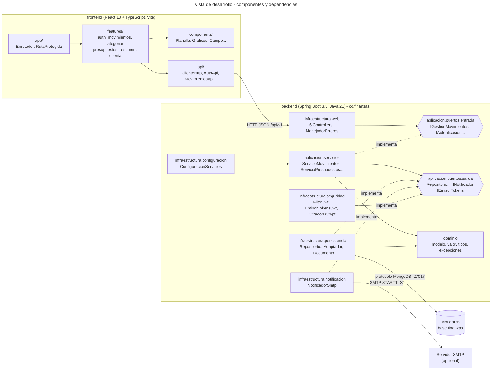

# Vista de desarrollo (modelo 4+1 de Kruchten)

**Qué responde:** cómo está organizado el código en módulos y paquetes, y quién depende de quién. Coincide con FUN-01 y DEV-01 del `.vpp`.

## 1. Componentes, paquetes e interfaces

**Leyenda:**

- rectángulo: módulo o paquete;
- `-->`: depende de (usa);
- `-.->|implementa|`: realiza una interfaz;
- hexágono: interfaz (puerto);
- cilindro: base de datos.



**Decisiones de diseño:**

- Las dependencias del backend **solo apuntan hacia adentro**: infraestructura → aplicación → dominio. El dominio no importa Spring ni MongoDB, y la prueba `backend/src/test/java/co/finanzas/arquitectura` (ArchUnit) falla si alguien rompe la regla.
- Los puertos (hexágonos) son las únicas interfaces entre capas. `ConfiguracionServicios` arma los servicios a mano con sus adaptadores, sin anotaciones de Spring en la capa de aplicación.
- En el frontend, cada `feature` (pantalla) llama a la API solo a través de `api/`. `ClienteHttp` añade el token y renueva la sesión en un único lugar.
- El frontend y el backend son dos módulos que se construyen por separado (`npm` y `mvnw`). Solo se comunican por HTTP con JSON.

## 2. Estructura de carpetas real

```text
PROYECTO FINAL DISEÑO/
├── backend/                  API REST (Maven, Spring Boot 3.5, Java 21)
│   ├── pom.xml, mvnw         construcción y dependencias
│   ├── Dockerfile            imagen para producción (build maven:3.9.11-eclipse-temurin-21 → runtime eclipse-temurin:21-jre-alpine)
│   └── src/
│       ├── main/java/co/finanzas/
│       │   ├── dominio/          entidades, objetos de valor, enums y excepciones (sin frameworks)
│       │   ├── aplicacion/       puertos de entrada y salida, servicios (casos de uso) y DTO
│       │   └── infraestructura/  web (controllers), persistencia (MongoDB), seguridad (JWT, BCrypt),
│       │                         notificacion (SMTP) y configuracion (beans)
│       ├── main/resources/       application.yml (puerto 8080, URI de MongoDB, perfiles)
│       └── test/java/co/finanzas/ dominio, aplicacion, integracion y arquitectura (ArchUnit)
├── frontend/                 SPA (Vite 7.3.8, React 18, TypeScript, react-router-dom 6.30.6)
│   ├── src/app/              enrutador y ruta protegida
│   ├── src/features/         una carpeta por funcionalidad: auth, movimientos, categorias, presupuestos, resumen, cuenta
│   ├── src/components/       componentes reutilizables (Plantilla, Graficos, DialogoConfirmacion…)
│   ├── src/api/              cliente HTTP y una clase por recurso REST
│   ├── e2e/                  pruebas Playwright (flujo-usuario.spec.ts, capturas.spec.ts)
│   └── vercel.json           configuración del despliegue estático
├── base-de-datos/            scripts de MongoDB: colecciones con $jsonSchema, índices, categorías predeterminadas, datos demo
├── postman/                  colección y entornos (local y producción) de las pruebas de la API
├── modelo/                   proyectos de Visual Paradigm (.vpp)
├── docs/                     documentación (vistas 4+1, ADR, requisitos y evidencias de pruebas)
├── render.yaml               despliegue planificado de la API en Render
└── iniciar.cmd               arranque local: comprueba que el servicio MongoDB esté corriendo, inicia la API y el frontend, y abre el navegador
```

| Carpeta | Capa | Depende de |
|---|---|---|
| `dominio/` | Negocio (núcleo) | Nada (solo el JDK) |
| `aplicacion/` | Negocio (casos de uso) | `dominio/` |
| `infraestructura/web` | Presentación (API) | `aplicacion/puertos/entrada` |
| `infraestructura/persistencia` | Datos | `aplicacion/puertos/salida`, `dominio/`, Spring Data MongoDB |
| `frontend/src` | Presentación (UI) | La API REST, por HTTP |

## Supuestos

- La lista de componentes de `frontend/src/components/` es parcial. Se nombran solo los más representativos.
- La carpeta `backend/target/` se omite porque la genera la compilación.
