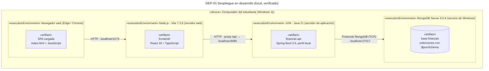
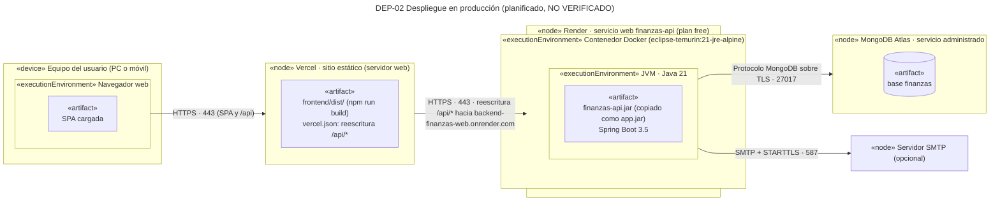

# Vista de despliegue (modelo 4+1 de Kruchten)

**Qué responde:** en qué máquinas y plataformas corre cada artefacto, y por qué protocolo y puerto se comunican. Coincide con DEP-01 y DEP-02 del `.vpp` y con `Finanzas_Personales_despliegues.vpp`.

**Leyenda (para los dos diagramas):**

| Notación | Significado |
|---|---|
| `«device»` | Equipo físico |
| `«executionEnvironment»` | Plataforma de software donde corre un artefacto (Navegador, Node.js, JVM, MongoDB, Docker) |
| `«node»` | Servicio administrado en la nube |
| `«artifact»` | Unidad desplegable: archivo, carpeta o base de datos |
| Flecha con etiqueta | Canal de comunicación, con su protocolo y puerto |

Corresponden a los cuatro nodos típicos:

| Nodo típico | Desarrollo | Producción |
|---|---|---|
| Cliente | Navegador | Navegador |
| Servidor web | Vite | Vercel |
| Servidor de aplicación | JVM | Render |
| Base de datos | MongoDB | MongoDB Atlas |

## 1. Entorno de desarrollo (verificado)

Es lo que corre hoy en el computador del estudiante con `iniciar.cmd`.

**Decisiones de diseño:**

- Todo corre en un solo equipo, pero en **procesos separados**: MongoDB nunca está "dentro" de la JVM, y por eso se dibuja como otro entorno de ejecución.
- Vite actúa como proxy de `/api`. Así el navegador ve un solo origen (`:5173`) y no hace falta abrir CORS en desarrollo.
- Controller, Service y Repository **no** son tres servidores: son clases del mismo artefacto `finanzas-api`, dentro de una sola JVM.

## 2. Entorno de producción (planificado, NO VERIFICADO)

Se basa en `frontend/vercel.json`, `render.yaml` y `backend/Dockerfile`.

**Decisiones de diseño:**

- Se pasa de desarrollo a producción cambiando **dónde** corre cada artefacto, no el código: es la misma `finanzas-api` y el mismo `frontend`, configurados con variables de entorno (`MONGODB_URI`, `JWT_SECRET`, `SPRING_MAIL_*`).
- Vercel reescribe `/api/*` hacia Render. El navegador sigue viendo un solo origen, y la cookie `refresh_token` funciona sin CORS entre dominios.
- La API corre en Docker, como usuario no root (`USER app`). `JAVA_OPTS="-XX:MaxRAMPercentage=75 -XX:+UseSerialGC"` ajusta la memoria a la del plan gratuito.
- La base es administrada (Atlas). Así no hay que mantener un servidor de MongoDB, y la conexión va cifrada con TLS.

## 3. Requisitos de hardware y software por nodo

| Nodo | Software (versión real del proyecto) | Hardware mínimo | Puerto |
|---|---|---|---|
| Navegador del usuario | Edge o Chrome actual, con JavaScript activo | Cualquier PC o móvil | (cliente) |
| Vite (desarrollo) | Node.js (24.21.0 en el equipo de desarrollo), Vite 7.3.8, React 18.3.1, TypeScript 5.9.3 | 2 núcleos y 4 GB de RAM *(supuesto)* | 5173 |
| JVM / finanzas-api (desarrollo) | Java 21, Spring Boot 3.5.16, Maven Wrapper | 2 núcleos y 4 GB de RAM *(supuesto)* | 8080 |
| MongoDB Server (desarrollo) | MongoDB 9.0.4 como servicio de Windows | 2 GB de RAM libres y 1 GB de disco *(supuesto)* | 27017 |
| Vercel (producción) | Hosting estático, con salida `dist/` | Lo administra Vercel | 443 |
| Render (producción) | Docker con `eclipse-temurin:21-jre-alpine`, plan free | Lo administra Render (plan free) **NO VERIFICADO** | 443 al exterior, 8080 en el contenedor (`EXPOSE 8080`) |
| MongoDB Atlas (producción) | Clúster administrado, conexión con TLS | Lo administra Atlas **NO VERIFICADO** | 27017 |
| Servidor SMTP (opcional) | Cualquier SMTP con STARTTLS | Externo | 587 |

## Supuestos

- **NO VERIFICADO:** el entorno de producción no está publicado con esta versión (ver `docs/INFORME_FINAL.md`, sección 0). El diagrama describe lo que configuran `render.yaml`, `vercel.json` y el `Dockerfile`.
- El puerto 587 del SMTP es el estándar de STARTTLS. El puerto real depende de `SPRING_MAIL_PORT`, que no está fijado en el repositorio.
- El puerto 27017 en Atlas es el predeterminado. La URI real (`MONGODB_URI`) es secreta y no está en el repositorio.
- Los requisitos de hardware de desarrollo son estimaciones razonables para ejecutar los tres procesos a la vez. No se midieron.
- Postman/newman y MongoDB Compass no se dibujan, ni aquí ni en el `.vpp`: son herramientas de prueba e inspección, no forman parte del sistema. Las pruebas de la API están en `docs/evidencias/pruebas/postman-newman.log`.
