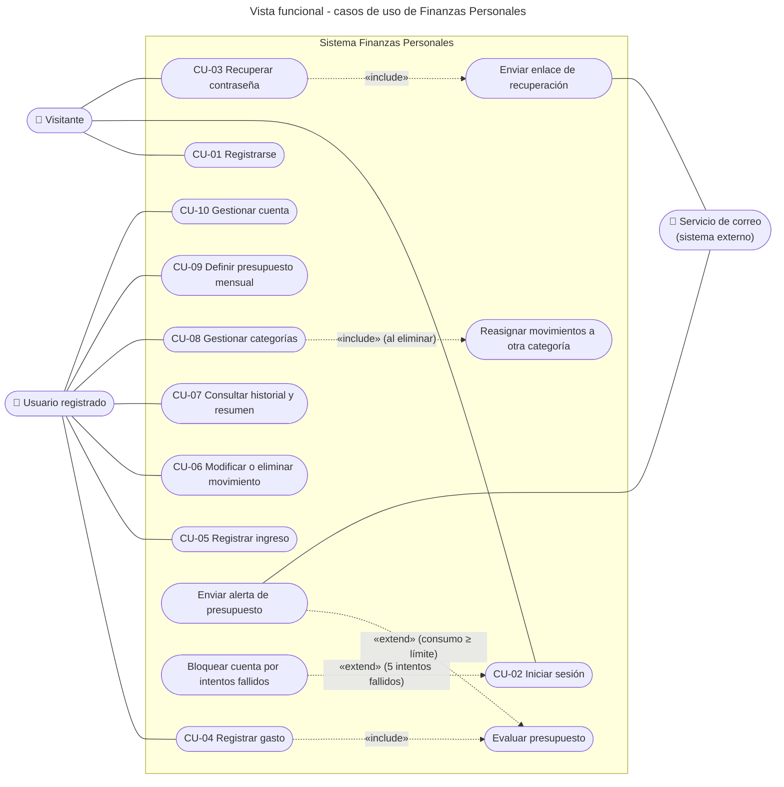
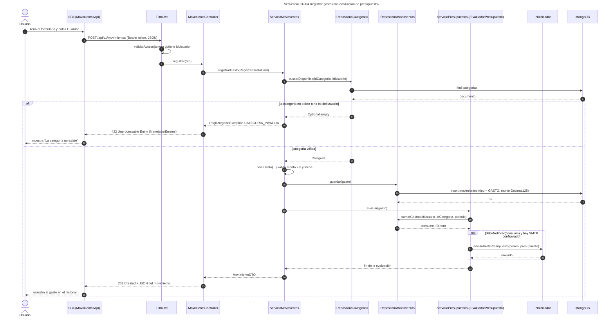
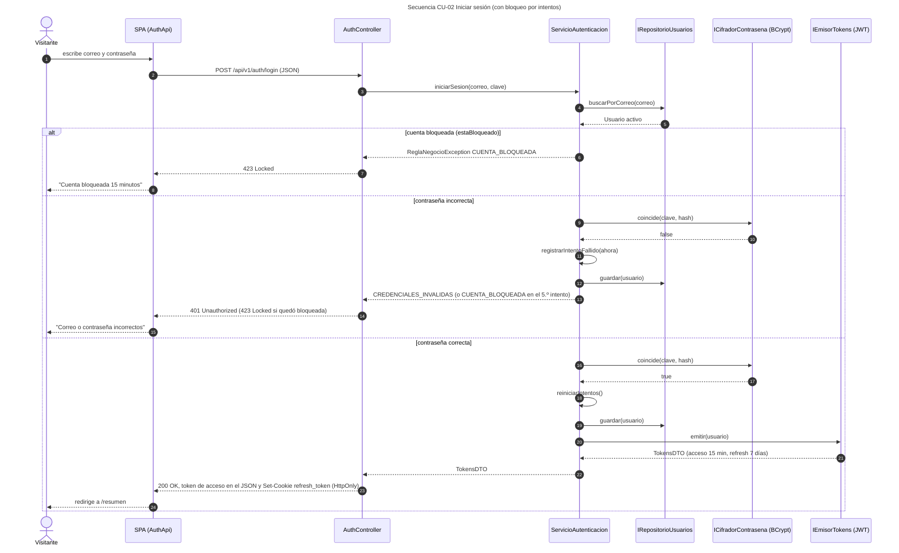

# Vista funcional y escenarios (modelo 4+1 de Kruchten)

**Qué responde:** quién usa el sistema, qué puede hacer y cómo colaboran los objetos en los flujos más importantes. Los casos de uso salen de los puertos de entrada (`aplicacion/puertos/entrada/*.java`) y de las rutas REST de los controllers.

## 1. Diagrama de casos de uso

**Leyenda:**

- figura con 👤: actor;
- óvalo: caso de uso;
- línea continua: el actor participa;
- `«include»`: el caso base **siempre** ejecuta al incluido;
- `«extend»`: el caso extensor **a veces** se añade al base, si se cumple una condición.

Mermaid no tiene un diagrama de casos de uso nativo, así que se dibuja con un `flowchart`.

| Caso de uso | Puerto y método | Endpoint REST |
|---|---|---|
| CU-01 Registrarse | `IAutenticacion.registrar` | `POST /api/v1/auth/registro` → 201 |
| CU-02 Iniciar sesión | `IAutenticacion.iniciarSesion` | `POST /api/v1/auth/login` → 200 |
| CU-03 Recuperar contraseña | `solicitarRecuperacion` y `restablecerContrasena` | `POST /auth/recuperacion` y `POST /auth/restablecer` |
| CU-04 y CU-05 Registrar gasto o ingreso | `IGestionMovimientos.registrarGasto` y `registrarIngreso` | `POST /api/v1/movimientos` → 201 |
| CU-06 Modificar o eliminar movimiento | `modificar` y `eliminar` | `PUT` y `DELETE /api/v1/movimientos/{id}` (el borrado responde 204) |
| CU-07 Consultar historial y resumen | `IConsultaFinanciera` | `GET /movimientos`, `GET /movimientos/{id}` y `GET /resumen` |
| CU-08 Gestionar categorías | `IGestionCategorias` | `GET`, `POST`, `PATCH` y `DELETE /api/v1/categorias` |
| CU-09 Definir presupuesto mensual | `IGestionPresupuestos` | `PUT`, `GET` y `DELETE /api/v1/presupuestos` |
| CU-10 Gestionar cuenta | `IGestionCuenta` | `GET`, `PATCH`, `PUT /contrasena` y `DELETE /api/v1/cuenta` |
| Evaluar presupuesto | `IEvaluadorPresupuesto.evaluar` | Ninguno: es interno y lo llama CU-04 |

**Decisiones de diseño:**

- "Evaluar presupuesto" es un `«include»` porque `ServicioMovimientos.registrarGasto` **siempre** llama a `evaluador.evaluar(g)`. Enviar la alerta es un `«extend»` porque solo ocurre si `debeNotificar(consumo)` es verdadero y hay SMTP configurado.
- El "Servicio de correo" es un actor secundario: el sistema lo usa, pero él nunca inicia un caso de uso.
- Los casos de uso del Usuario registrado exigen un token JWT válido, que comprueba `FiltroJwt`. Por eso se separaron del Visitante.

## 2. Secuencia 1: registrar un gasto (CU-04)

**Leyenda:**

- `->>`: mensaje síncrono;
- `-->>`: respuesta;
- `alt` / `else`: alternativas;
- `opt`: fragmento opcional.

Los números son el orden de los mensajes.

**Decisiones de diseño:**

- El controlador no sabe de presupuestos. Es el servicio quien encadena la evaluación, y así la regla RF-20 vive en la capa de negocio.
- La categoría se busca con el `idUsuario` del token, nunca con uno enviado en el JSON. Así se evita que un usuario use las categorías de otro.
- Un error de regla de negocio sube como excepción y `ManejadorErrores` lo convierte en `422`, con un cuerpo `ProblemDetail` y el código `CATEGORIA_INVALIDA`.

## 3. Secuencia 2: iniciar sesión (CU-02)

**Decisiones de diseño:**

- El mensaje de error es el mismo si el correo no existe o si la clave es incorrecta. Así no se revela qué correos están registrados.
- El token de acceso vive solo en memoria (`AlmacenTokens.ts`) y el de renovación en una cookie `HttpOnly`, que JavaScript no puede leer. Esto reduce el riesgo de robo por XSS.
- El bloqueo (RN-08: 5 intentos fallidos, 15 minutos) es una regla de `Usuario`, no del controlador. Por eso se puede probar con una prueba unitaria del dominio.

## Supuestos

- Los textos que muestra la SPA en cada error son aproximados. Los códigos HTTP y los códigos de error (`CATEGORIA_INVALIDA`, `CREDENCIALES_INVALIDAS`, `CUENTA_BLOQUEADA`) sí son los del código.
- Si el correo no existe, `buscarActivo(correo)` lanza `CREDENCIALES_INVALIDAS` (401) sin consultar BCrypt. Esto se verificó en `ServicioAutenticacion.java`, pero no se dibujó como rama aparte para no recargar el diagrama.
- La numeración CU-01 a CU-10 es de este documento. Su correspondencia con RF y HU está en FUN-01 y en `docs/06-trazabilidad`.
