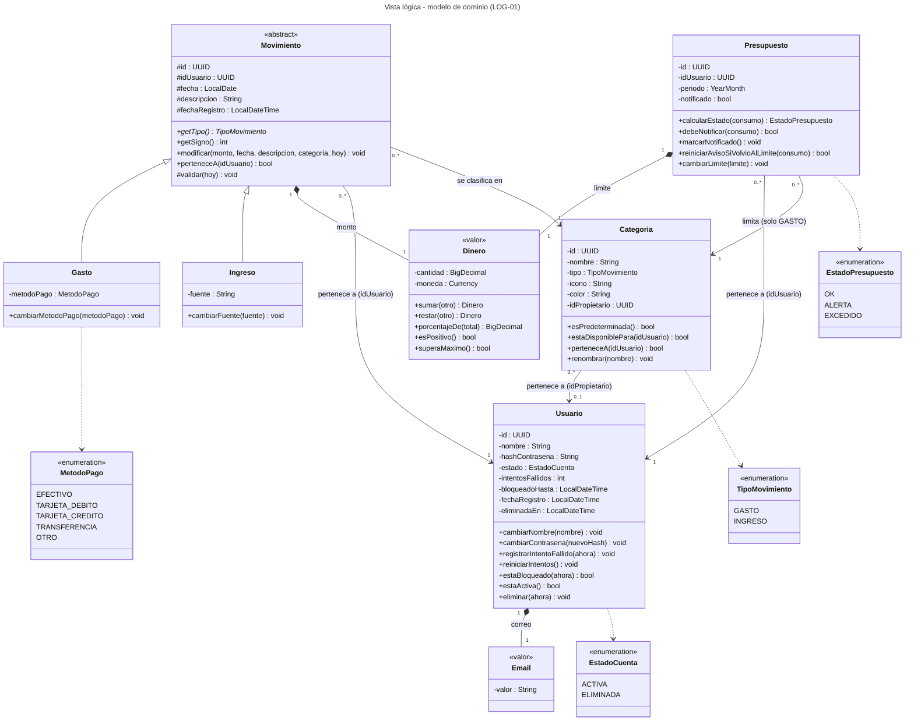
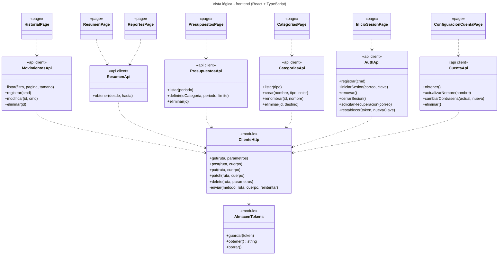
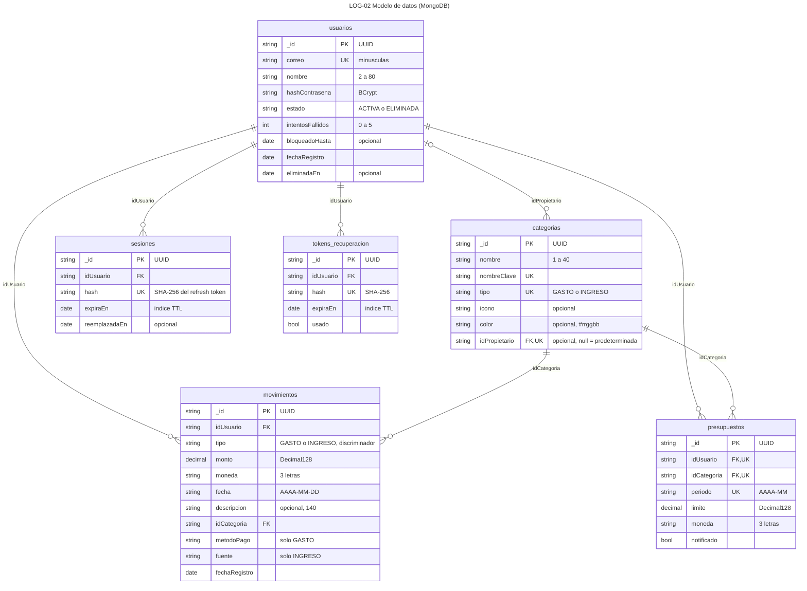

# Vista lógica (modelo 4+1 de Kruchten)

**Qué responde:** qué clases tiene el sistema (frontend, backend y base de datos), qué saben hacer y cómo se relacionan. Todo sale de `backend/src/main/java/co/finanzas/**` y coincide con LOG-01 y DEV-01 del `.vpp`, después de las correcciones de [correcciones-vpp.md](correcciones-vpp.md).

## 1. Clases agrupadas por capas

Este diagrama muestra el corte vertical del caso de uso más usado, "registrar un gasto", a través de las tres capas:

- **presentación** (`infraestructura/web`);
- **negocio** (`aplicacion` y `dominio`);
- **datos** (`infraestructura/persistencia`).

Las otras cinco parejas Controller–Servicio siguen el mismo patrón (ver la tabla de la sección 3).

**Leyenda:**

| Símbolo | Significado |
|---|---|
| `<|--` | Herencia |
| `..|>` | Realización (implementa una interfaz) |
| `*--` | Composición |
| `-->` | Asociación con multiplicidad |
| `..>` | Dependencia (usa) |
| `+ - # ~` | Público, privado, protegido, de paquete |

```mermaid
---
title: Vista lógica - clases por capas (caso registrar gasto)
---
classDiagram
    namespace presentacion {
        class MovimientoController {
            -gestion : IGestionMovimientos
            +registrar(req) ResponseEntity
            +modificar(id, req) MovimientoDTO
            +eliminar(id) void
        }
        class ManejadorErrores {
            +reglaNegocio(e) ResponseEntity
            +noEncontrado(e) ResponseEntity
        }
    }
    namespace negocio {
        class IGestionMovimientos {
            <<interface>>
            +registrarGasto(cmd) MovimientoDTO
            +registrarIngreso(cmd) MovimientoDTO
            +modificar(idUsuario, idMovimiento, cmd) MovimientoDTO
            +eliminar(idUsuario, idMovimiento) void
        }
        class ServicioMovimientos {
            -repoMovimientos : IRepositorioMovimientos
            -repoCategorias : IRepositorioCategorias
            -evaluador : IEvaluadorPresupuesto
            +registrarGasto(cmd) MovimientoDTO
            +registrarIngreso(cmd) MovimientoDTO
            +modificar(idUsuario, idMovimiento, cmd) MovimientoDTO
            +eliminar(idUsuario, idMovimiento) void
        }
        class IEvaluadorPresupuesto {
            <<interface>>
            +evaluar(gasto) void
        }
        class ServicioPresupuestos {
            +definir(idUsuario, idCategoria, periodo, limite) PresupuestoDTO
            +listar(idUsuario, periodo) List
            +eliminar(idUsuario, idPresupuesto) void
            +evaluar(gasto) void
        }
        class IRepositorioMovimientos {
            <<interface>>
            +guardar(m) void
            +eliminar(m) void
            +buscarDeUsuario(idUsuario, id) Optional
            +sumarGastos(idUsuario, idCategoria, periodo) Dinero
        }
        class IRepositorioCategorias {
            <<interface>>
            +guardar(c) void
            +buscarDisponible(id, idUsuario) Optional
            +listarDisponibles(idUsuario, tipo) List
        }
        class INotificador {
            <<interface>>
            +enviarRecuperacion(correo, enlace) void
            +enviarAlertaPresupuesto(correo, p) void
        }
        class Movimiento {
            <<abstract>>
            #id : UUID
            #idUsuario : UUID
            #fecha : LocalDate
            +modificar(monto, fecha, descripcion, categoria, hoy) void
        }
        class Gasto {
            -metodoPago : MetodoPago
            +cambiarMetodoPago(metodoPago) void
        }
        class Ingreso {
            -fuente : String
            +cambiarFuente(fuente) void
        }
        class Categoria {
            -id : UUID
            -nombre : String
            -tipo : TipoMovimiento
            +estaDisponiblePara(idUsuario) bool
        }
    }
    namespace datos {
        class RepositorioMovimientosAdaptador {
            -mongo : MovimientoRepositorioMongo
            -plantilla : MongoTemplate
            -categorias : RepositorioCategoriasAdaptador
            +guardar(m) void
            +sumarGastos(idUsuario, idCategoria, periodo) Dinero
        }
        class RepositorioCategoriasAdaptador {
            -mongo : CategoriaRepositorioMongo
            +buscarDisponible(id, idUsuario) Optional
        }
        class MovimientoDocumento {
            ~id : String
            ~idUsuario : String
            ~tipo : String
            ~monto : BigDecimal
            ~idCategoria : String
            ~metodoPago : String
            ~fuente : String
        }
        class NotificadorSmtp {
            +enviarRecuperacion(correo, enlace) void
            +enviarAlertaPresupuesto(correo, p) void
        }
    }
    MovimientoController ..> IGestionMovimientos : usa
    ServicioMovimientos ..|> IGestionMovimientos
    ServicioPresupuestos ..|> IEvaluadorPresupuesto
    ServicioMovimientos ..> IEvaluadorPresupuesto : evalua el gasto
    ServicioMovimientos ..> IRepositorioMovimientos
    ServicioMovimientos ..> IRepositorioCategorias
    ServicioPresupuestos ..> INotificador
    RepositorioMovimientosAdaptador ..|> IRepositorioMovimientos
    RepositorioCategoriasAdaptador ..|> IRepositorioCategorias
    NotificadorSmtp ..|> INotificador
    RepositorioMovimientosAdaptador ..> MovimientoDocumento : convierte
    RepositorioMovimientosAdaptador --> "1" RepositorioCategoriasAdaptador : categorias
    Movimiento <|-- Gasto
    Movimiento <|-- Ingreso
    Movimiento "0..*" --> "1" Categoria
    ServicioMovimientos ..> Gasto : crea
```

**Decisiones de diseño:**

- Es una arquitectura hexagonal (puertos y adaptadores). El servicio solo conoce interfaces (`IRepositorio…`, `INotificador`). Gracias a eso, MongoDB o SMTP se pueden cambiar sin tocar las reglas de negocio, y las pruebas usan dobles en memoria.
- El controlador no tiene lógica: convierte JSON en un comando (`RegistrarGastoCmd`) y delega. Los errores se traducen a HTTP en un solo lugar: `ManejadorErrores` (400, 401, 404, 409, 422, 423).
- `MovimientoDocumento` es distinto de `Movimiento`. El dominio no tiene anotaciones de Spring ni de MongoDB, y la prueba `ArquitecturaTest` (ArchUnit) lo verifica.
- Registrar un gasto llama a `IEvaluadorPresupuesto`: si el gasto supera el presupuesto, se avisa por correo (RF-20).

## 2. Modelo de dominio completo

Es el mismo diagrama corregido de [correcciones-vpp.md](correcciones-vpp.md#log-01-corregido-mermaid). Pertenece a la capa de negocio.

**Decisiones de diseño:** ver [correcciones-vpp.md](correcciones-vpp.md#log-01-corregido-mermaid). En resumen:

- herencia `Movimiento → Gasto / Ingreso`;
- objetos de valor `Dinero` y `Email` en composición;
- relaciones con `Usuario` por identificador.

## 3. Capa de presentación (frontend)

Muestra lo mismo que el frontend de DEV-01: cada página usa un cliente de la API, y todos los clientes pasan por `ClienteHttp`.

**Leyenda:**

- `«page»`: pantalla con ruta propia;
- `«api client»`: objeto que llama a un recurso REST;
- `«module»`: módulo TypeScript;
- `..>`: dependencia (usa);
- `-`: privado.

**Decisiones de diseño:**

- Las páginas nunca llaman a `fetch` directamente: usan un cliente por recurso (`MovimientosApi` ↔ `MovimientoController`). Si cambia la API, se toca un solo archivo.
- `ClienteHttp.enviar` es el único punto que habla con el servidor:
  - añade el token `Bearer`;
  - envía la cookie (`credentials: 'include'`);
  - si recibe un 401, renueva la sesión una vez y reintenta.
- El token de acceso vive en memoria (`AlmacenTokens`) y no en `localStorage`. Esto reduce el riesgo de robo por XSS.

## 4. Modelo de datos (MongoDB, base `finanzas`)

Coincide con el diagrama **LOG-02 Modelo de datos (MongoDB)** del `.vpp`. Sale de:

- `base-de-datos/01_colecciones.js`, que define los esquemas `$jsonSchema`;
- `base-de-datos/02_indices.js`, que define los índices;
- las clases `*Documento.java`.

**Leyenda:**

- `PK`: clave `_id`;
- `FK`: referencia por UUID a otra colección. MongoDB no la obliga; la verifica el servicio;
- `UK`: parte de un índice único;
- `||--o{`: uno a muchos;
- `|o--o{`: cero o uno a muchos.

En el `.vpp`, `[0..1]` marca un campo opcional y las operaciones `unique(...)`, `index(...)` y `ttl(...)` son los índices.

| Colección | Índices (`02_indices.js`) | Para qué |
|---|---|---|
| `usuarios` | único `correo` | No permitir correos repetidos (RN-06) |
| `categorias` | único `idPropietario + tipo + nombreClave` | Que un usuario no repita el nombre de una categoría |
| `movimientos` | `idUsuario + fecha + fechaRegistro`, e `idUsuario + idCategoria + fecha + fechaRegistro` | Historial paginado y suma de gastos por categoría (RNF-06) |
| `presupuestos` | único `idUsuario + idCategoria + periodo`, e `idUsuario + periodo` | Un presupuesto por categoría y mes (RN-10) |
| `sesiones` | único `hash`, `idUsuario` y TTL `expiraEn` | Buscar el refresh token, cerrar todas las sesiones de un usuario y borrar las vencidas |
| `tokens_recuperacion` | único `hash` y TTL `expiraEn` | Que el enlace de recuperación caduque solo |

**Decisiones de diseño:**

- Se usan **referencias por UUID** y no documentos embebidos. Los movimientos crecen sin límite (embeberlos en `usuarios` superaría los 16 MB por documento) y se consultan solos y paginados.
- `movimientos` es **una sola colección** con el discriminador `tipo`, igual que la herencia `Movimiento → Gasto / Ingreso` del dominio. El historial mezcla gastos e ingresos en una sola consulta.
- El dinero se guarda como `Decimal128` (`$jsonSchema` exige `bsonType: "decimal"`), nunca como `double`.
- Los tokens se guardan como **hash SHA-256** y no en claro, y los índices TTL los borran al vencer.

## 5. Correspondencia Controller → Puerto → Servicio → Adaptador

| Controller (presentación) | Puerto de entrada | Servicio (negocio) | Puertos de salida → adaptador (datos) |
|---|---|---|---|
| `AuthController` | `IAutenticacion` | `ServicioAutenticacion` | `IRepositorioUsuarios` → `RepositorioUsuariosAdaptador`, `ICifradorContrasena` → `CifradorBCrypt`, `IEmisorTokens` → `EmisorTokensJwt`, `INotificador` → `NotificadorSmtp` |
| `MovimientoController` | `IGestionMovimientos` | `ServicioMovimientos` | `IRepositorioMovimientos`, `IRepositorioCategorias` y `IEvaluadorPresupuesto` |
| `ConsultaController` | `IConsultaFinanciera` | `ServicioConsultaFinanciera` | `IRepositorioMovimientos` y `IRepositorioPresupuestos` |
| `CategoriaController` | `IGestionCategorias` | `ServicioCategorias` | `IRepositorioCategorias`, `IRepositorioMovimientos` y `IRepositorioPresupuestos` |
| `PresupuestoController` | `IGestionPresupuestos` | `ServicioPresupuestos` | `IRepositorioPresupuestos`, `IRepositorioMovimientos`, `IRepositorioCategorias`, `IRepositorioUsuarios` y `INotificador` |
| `CuentaController` | `IGestionCuenta` | `ServicioCuenta` | `IRepositorioUsuarios`, `ICifradorContrasena` y `IEmisorTokens` |

## Supuestos

- Los nombres de los métodos de `ManejadorErrores` son los reales, pero solo se dibujan dos de sus seis manejadores.
- `MovimientoDocumento` usa campos de visibilidad de paquete (`~`). `monto` es `BigDecimal` y se guarda como `Decimal128` gracias a `@Field(targetType = DECIMAL128)`. No se dibujan `moneda`, `fecha`, `descripcion` ni `fechaRegistro`.
- Los puertos de salida de la tabla salen de los constructores de `ConfiguracionServicios.java` (verificado). En `ServicioAutenticacion` y `ServicioCuenta` también se inyecta el puerto `IEmisorTokens`.
