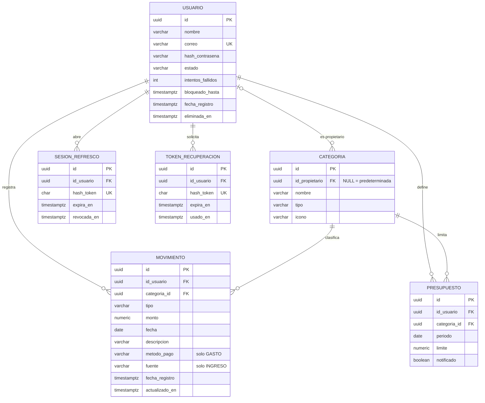

# Auditoría de base de datos — Finanzas Personales

Rol: db-architect. Fecha: 2026-11-09. Alcance: solo lectura de originales; este archivo es el único producto.

## 1. ¿Existe un modelo físico?

**No.** Evidencia:

- `Glob **/*.{sql,prisma,ddl}` no devuelve ningún archivo; no hay carpetas de migraciones, `package.json` ni código fuente. El repositorio contiene `CLAUDE.md`, `docs/`, `exportes/` (PNG de diagramas) y `modelo/` (archivos `.vpp` e `imagenes`).
- La documentación **promete** artefactos que no existen: `V1__esquema.sql` y `V2__categorias_predeterminadas.sql` (Flyway) en `VISTA_DESPLIEGUE.md` §5.3 y RF-14, y un "esquema de la Vista de Desarrollo §4.3" que NO VERIFICADO (no se auditó ese apartado; el modelo de datos físico no aparece en `VISTA_LOGICA.md`).
- El único modelo de datos es el **diagrama de dominio UML** (`exportes/LOG-01 Dominio.png`, leído como imagen) y su descripción en `VISTA_LOGICA.md`. La consulta directa a la copia SQLite del `.vpp` no se ejecutó; los atributos se tomaron del PNG y de la vista lógica. **NO VERIFICADO** contra el `.vpp` (posibles diferencias de tipos o multiplicidades no visibles en el PNG).
- ADR-003 (aceptado) fija: PostgreSQL 16, `NUMERIC(14,2)`, `UUID`, Flyway, `CHECK`/`UNIQUE`/`FK ON DELETE CASCADE`, índices compuestos por `id_usuario`.

Conclusión: la auditoría es sobre el **diseño lógico-conceptual** y sobre lo que el ADR y los RF exigen del esquema. Lo de §4 es una propuesta, no ejecutada.

## 2. Entidades y atributos derivados del dominio

| Entidad (UML) | Atributos UML | Observaciones |
|---|---|---|
| Usuario | id UUID, nombre, correo (Email VO), hashContrasena, estado (EstadoCuenta), intentosFallidos int, bloqueadoHasta LocalDateTime, fechaRegistro LocalDateTime | Composición con Movimiento y Presupuesto (0..*); agregación a Categoria personalizadas |
| Movimiento (abstracta) | id, idUsuario, monto Dinero, fecha LocalDate, descripcion, fechaRegistro LocalDateTime | Generalización {complete, disjoint} Gasto/Ingreso; asociación 1 Categoria |
| Gasto | metodoPago (EFECTIVO, TARJETA_DEBITO, TARJETA_CREDITO, TRANSFERENCIA, OTRO) | |
| Ingreso | fuente String | |
| Categoria | id, nombre, tipo (INGRESO/GASTO), icono, idPropietario UUID (null = predeterminada) | |
| Presupuesto | id, idUsuario, periodo YearMonth, limite Dinero, notificado boolean | Asociación "limita" a Categoria |
| Dinero (VO) | cantidad BigDecimal, moneda Currency (COP por defecto) | Se incrusta en Movimiento.monto y Presupuesto.limite |
| Email (VO) | valor String | Se incrusta en Usuario.correo |
| Enumeraciones | TipoMovimiento, MetodoPago, EstadoCuenta (ACTIVA, BLOQUEADA, ELIMINADA), EstadoPresupuesto (OK, ALERTA, EXCEDIDO) | EstadoPresupuesto es **derivado** (RN-11), no se persiste |

Entidades **no presentes en el dominio pero exigidas por los RF**: token de renovación (RF-03/05/06) y token de recuperación de contraseña (RF-07/08). Ver DB-01.

## 3. Hallazgos

Gravedad: Crítica / Alta / Media / Baja.

### DB-01 — Faltan tablas de sesión y recuperación (Alta)
RF-05/06 (rotación y revocación de refresh token), RF-08 ("revoca todas las sesiones") y RF-07 (token de un solo uso, 30 min) requieren estado persistente, pero el dominio no define entidad alguna (`IEmisorTokens.revocar` existe sin respaldo de datos). Sin ella la revocación es imposible con JWT sin estado.
Propuesta: `sesion_refresco` (solo el hash SHA-256 del token, `expira_en`, `revocada_en`, `reemplazado_por` para detectar reutilización) y `token_recuperacion` (hash, `expira_en`, `usado_en`). Añadirlas al modelo UML.

### DB-02 — Tipo del monto: coherencia ADR vs UML (Media)
Positivo: ADR-003 usa `NUMERIC(14,2)` y la vista lógica prohíbe `double` (RNF-03); 14 dígitos cubren RN-01 (999 999 999 999,99 = 12+2). Pero el UML modela `Dinero(cantidad, moneda)` y el ADR solo define cantidad: no se dice dónde queda la moneda.
Propuesta: decidir explícitamente. Recomendado: sistema monomoneda COP sin columna de moneda; si se prevé multimoneda, `moneda CHAR(3)`. Documentarlo en el ADR. Agregar `CHECK (monto > 0 AND monto <= 999999999999.99)` (RN-01), que el ADR menciona de forma genérica pero no define.

### DB-03 — Fechas y zona horaria (Media)
`fecha` como `LocalDate` es correcto como `DATE` (día contable del usuario). `fechaRegistro` y `bloqueadoHasta` son `LocalDateTime` sin zona: mapeados a `TIMESTAMP` son ambiguos entre servidor y usuario y hacen frágil el bloqueo de 15 min (RN-08). RN-02 admite "hoy + 1 día" como parche, señal de que la zona del usuario no está modelada.
Propuesta: `TIMESTAMPTZ` (UTC) para instantes; `DATE` para `fecha`. El `CHECK` de RN-02 no puede basarse en `CURRENT_DATE` (no inmutable, rompe restauraciones): mantenerlo en la aplicación. `periodo` como `DATE` (primer día del mes) con `CHECK (periodo = date_trunc('month', periodo))`, pues `YearMonth` no existe en PostgreSQL. Una `zona_horaria` por usuario: NO VERIFICADO que sea requisito.

### DB-04 — Enumeraciones sin estrategia de persistencia (Media)
Cuatro enums en el UML. Con `ORDINAL` de JPA, reordenar el enum corrompe datos. Propuesta: `VARCHAR` + `CHECK` (más fácil de migrar con Flyway que `ENUM` nativo) y `@Enumerated(EnumType.STRING)`. `EstadoPresupuesto` no debe persistirse.

### DB-05 — Generalización Gasto/Ingreso sin estrategia de mapeo (Alta)
`Movimiento` abstracta con `Gasto(metodoPago)` e `Ingreso(fuente)` y OCL `{complete, disjoint}`; no hay decisión de mapeo. Historial (RF-21), resumen (RF-23) y filtros (RF-22) mezclan ambos tipos ordenando por fecha: la **tabla única** es la adecuada.
Propuesta: tabla `movimiento` con `tipo`, `metodo_pago` y `fuente` anulables y `CHECK` que garantice la disyunción. Sacrifica 3FN estricta (atributos condicionales por `tipo`), aceptable y documentado.

### DB-06 — RN-03 (tipo de categoría = tipo del movimiento) no es declarativa (Alta)
Un `CHECK` no cruza tablas; un bug de aplicación guardaría ingresos con categoría de gasto y falsearía el resumen.
Propuesta: `UNIQUE (id, tipo)` en `categoria` y FK compuesta `movimiento (categoria_id, tipo) -> categoria (id, tipo)`. Misma técnica para RN-10 en `presupuesto` (tipo fijo `'GASTO'`).

### DB-07 — Propiedad multiusuario y categorías de otros usuarios (Crítica)
RN-04/RN-05: un usuario solo usa categorías predeterminadas o propias. El esquema por sí solo no lo impide: `movimiento.categoria_id` podría apuntar a la categoría de otro usuario (fuga entre inquilinos). Toda consulta sin `WHERE id_usuario = ?` expone datos ajenos.
Propuesta: (a) `id_usuario NOT NULL` con FK en todas las tablas de datos; (b) trigger que valide que la categoría es predeterminada (`id_propietario IS NULL`) o del mismo usuario; (c) opcional, Row Level Security con `current_setting('app.usuario_id')` como defensa en profundidad además del filtro por token (RN-05); (d) rol de runtime sin DDL (ya previsto en CP3).

### DB-08 — Unicidad con propietario NULL (Alta)
RN-09: nombre único por usuario y tipo. Con `id_propietario NULL` para predeterminadas, `UNIQUE (id_propietario, nombre, tipo)` no impide duplicados de predeterminadas (NULL distinto de NULL) y permite "Comida" y "comida".
Propuesta: dos índices únicos parciales con `lower(nombre)` (ver DDL). Si un nombre propio puede coincidir con una predeterminada, el RF no lo dice: NO VERIFICADO.

### DB-09 — Correo único y en minúsculas (Media)
RN-06. Un `UNIQUE` simple es sensible a mayúsculas si alguna ruta de escritura no normaliza. Propuesta: `CHECK (correo = lower(correo))` más `UNIQUE (correo)` (o `CITEXT`), con límite de longitud (254).

### DB-10 — Borrado: "ELIMINADA" vs `ON DELETE CASCADE` (Alta)
`EstadoCuenta` incluye `ELIMINADA` (borrado lógico) pero ADR-003 prescribe `FK ON DELETE CASCADE`: políticas contradictorias, sin campo `eliminada_en`. RF-17 reasigna movimientos antes de borrar la categoría, lo que exige `ON DELETE RESTRICT` en `movimiento.categoria_id`; con CASCADE se borrarían movimientos al borrar una categoría (pérdida silenciosa).
Propuesta: usuario con soft delete (`estado='ELIMINADA'` + `eliminada_en`) y purga según política; movimientos y presupuestos con borrado físico (RF-13); CASCADE solo desde `usuario` hacia hijos (purga) y RESTRICT hacia `categoria`. Documentar la retención de respaldos (30 días) frente a la supresión de datos.

### DB-11 — Unicidad de presupuesto (RN-10) (Alta)
No está definida como restricción en ADR/UML. RF-18 hace upsert (`PUT`): sin `UNIQUE (id_usuario, categoria_id, periodo)` hay carreras y duplicados.
Propuesta: `UNIQUE` explícito, `INSERT ... ON CONFLICT DO UPDATE`, `CHECK (limite > 0)`. Para RN-12 usar `UPDATE ... SET notificado = true WHERE notificado = false RETURNING` y garantizar una sola alerta bajo concurrencia.

### DB-12 — Intentos fallidos y bloqueo (Media)
`estado = BLOQUEADA` y `bloqueadoHasta` son redundantes: el bloqueo vence solo y el estado quedaría desactualizado. Actualizaciones concurrentes de login pueden perder incrementos.
Propuesta: derivar el bloqueo de `bloqueado_hasta > now()`; incremento atómico (`SET intentos = intentos + 1`); `CHECK (intentos_fallidos >= 0)`; o corregir el UML.

### DB-13 — Dato duplicado de tipo (Baja)
El tipo está en la subclase del movimiento y en la categoría (RN-03): anomalía de actualización potencial, controlada con la FK compuesta de DB-06.

### DB-14 — Normalización 1FN-3FN (Media)
- 1FN: sin atributos multivaluados; `Dinero` y `Email` son VO atómicos. OK.
- 2FN: claves simples (UUID); sin dependencias parciales. OK.
- 3FN: desviaciones: `Usuario.estado` vs `bloqueadoHasta` (DB-12); atributos condicionales de la tabla única de movimientos (DB-05); `tipo` duplicado (DB-13). No se almacenan agregados (consumo, totales): correcto, se calculan con `SUM` (RF-19/23).

### DB-15 — Índices (Media)
ADR dice "índices compuestos por `id_usuario`" sin definirlos. Consultas críticas: historial por usuario y fecha descendente (RF-21/22), resumen por rango (RF-23), gasto por categoría (RF-24), consumo de presupuesto (RF-19), login por correo (cubierto por `UNIQUE`).
Propuesta (ver DDL): `movimiento (id_usuario, fecha DESC, id)` y `movimiento (id_usuario, tipo, categoria_id, fecha)`; el desempate por `id` da paginación estable. Evitar sobre-indexar.

### DB-16 — Restricciones CHECK y longitudes (Media)
Nombre de usuario 2–80 (RF-01), categoría 1–40 (RN-09), descripción ≤ 140 (RF-09), `monto > 0`, `limite > 0`: el UML usa `String` sin límite. Propuesta: `VARCHAR(n)` y `CHECK` (ver DDL).

### DB-17 — Alineación UML y requisitos (Media)
- `Categoria.icono` existe en el UML pero ningún RF lo usa (NO VERIFICADO si algún mockup lo requiere).
- `Presupuesto` no tiene atributo `idCategoria` en el UML aunque la asociación "limita" existe; la multiplicidad del PNG es dudosa (NO VERIFICADO contra el `.vpp`).
- El OCL cubre RN-03, la parte GASTO de RN-10 y la generalización; RN-09, la unicidad de RN-10 y RN-01 (rango) no están en el OCL.
- RF-14: las predeterminadas cargan por Flyway; usar inserciones idempotentes.
- RF-20: sin bitácora de envíos/reintentos (opcional).

### DB-18 — Auditoría (Baja)
Solo `fechaRegistro`; RF-12 permite modificar movimientos y no hay `actualizado_en`. Propuesta: columna con trigger.

### DB-19 — Operación (Baja)
Respaldo diario a las 02:00 (RPO 24 h) sin prueba de restauración documentada. Flyway con rol distinto al de runtime: correcto. `gen_random_uuid()` genera UUID v4 (fragmenta índices); UUID v7 requeriría generación en la aplicación (NO VERIFICADO soporte nativo en PG16).

## 4. PROPUESTA (no ejecutada)

> Nada de lo siguiente se ha ejecutado contra una base de datos ni se ha creado como archivo de migración.

### 4.1 ER en Mermaid



### 4.2 DDL de referencia para PostgreSQL 16 — PROPUESTA (no ejecutada)

```sql
-- PROPUESTA (no ejecutada). Referencia para V1__esquema.sql

CREATE TABLE usuario (
    id                UUID PRIMARY KEY DEFAULT gen_random_uuid(),
    nombre            VARCHAR(80)  NOT NULL CHECK (char_length(nombre) >= 2),
    correo            VARCHAR(254) NOT NULL UNIQUE CHECK (correo = lower(correo)),
    hash_contrasena   VARCHAR(100) NOT NULL,
    estado            VARCHAR(10)  NOT NULL DEFAULT 'ACTIVA'
                      CHECK (estado IN ('ACTIVA','BLOQUEADA','ELIMINADA')),
    intentos_fallidos INT          NOT NULL DEFAULT 0 CHECK (intentos_fallidos >= 0),
    bloqueado_hasta   TIMESTAMPTZ,
    fecha_registro    TIMESTAMPTZ  NOT NULL DEFAULT now(),
    eliminada_en      TIMESTAMPTZ
);

CREATE TABLE categoria (
    id             UUID PRIMARY KEY DEFAULT gen_random_uuid(),
    id_propietario UUID REFERENCES usuario(id) ON DELETE CASCADE,  -- NULL = predeterminada
    nombre         VARCHAR(40) NOT NULL CHECK (char_length(btrim(nombre)) >= 1),
    tipo           VARCHAR(7)  NOT NULL CHECK (tipo IN ('GASTO','INGRESO')),
    icono          VARCHAR(40),
    UNIQUE (id, tipo)                       -- soporta FK compuestas (RN-03, RN-10)
);
-- RN-09 con propietario NULL
CREATE UNIQUE INDEX uq_categoria_propia
    ON categoria (id_propietario, tipo, lower(nombre)) WHERE id_propietario IS NOT NULL;
CREATE UNIQUE INDEX uq_categoria_predeterminada
    ON categoria (tipo, lower(nombre)) WHERE id_propietario IS NULL;

CREATE TABLE movimiento (
    id             UUID PRIMARY KEY DEFAULT gen_random_uuid(),
    id_usuario     UUID NOT NULL REFERENCES usuario(id) ON DELETE CASCADE,
    categoria_id   UUID NOT NULL,
    tipo           VARCHAR(7) NOT NULL CHECK (tipo IN ('GASTO','INGRESO')),
    monto          NUMERIC(14,2) NOT NULL CHECK (monto > 0 AND monto <= 999999999999.99), -- RN-01
    fecha          DATE NOT NULL,
    descripcion    VARCHAR(140),
    metodo_pago    VARCHAR(16),
    fuente         VARCHAR(80),
    fecha_registro TIMESTAMPTZ NOT NULL DEFAULT now(),
    actualizado_en TIMESTAMPTZ NOT NULL DEFAULT now(),
    -- RN-03: tipo del movimiento = tipo de la categoria; RESTRICT por RF-17
    FOREIGN KEY (categoria_id, tipo) REFERENCES categoria (id, tipo) ON DELETE RESTRICT,
    -- generalizacion {complete, disjoint}
    CHECK (
        (tipo = 'GASTO'   AND metodo_pago IN ('EFECTIVO','TARJETA_DEBITO','TARJETA_CREDITO','TRANSFERENCIA','OTRO') AND fuente IS NULL)
     OR (tipo = 'INGRESO' AND metodo_pago IS NULL)
    )
);
-- Pendiente: trigger que valide que la categoria sea predeterminada o del mismo usuario (RN-04)
CREATE INDEX ix_mov_usuario_fecha ON movimiento (id_usuario, fecha DESC, id);
CREATE INDEX ix_mov_usuario_tipo_cat_fecha ON movimiento (id_usuario, tipo, categoria_id, fecha);

CREATE TABLE presupuesto (
    id           UUID PRIMARY KEY DEFAULT gen_random_uuid(),
    id_usuario   UUID NOT NULL REFERENCES usuario(id) ON DELETE CASCADE,
    categoria_id UUID NOT NULL,
    tipo         VARCHAR(7) NOT NULL DEFAULT 'GASTO' CHECK (tipo = 'GASTO'),  -- RN-10
    periodo      DATE NOT NULL CHECK (periodo = date_trunc('month', periodo)::date),
    limite       NUMERIC(14,2) NOT NULL CHECK (limite > 0),
    notificado   BOOLEAN NOT NULL DEFAULT false,                              -- RN-12
    FOREIGN KEY (categoria_id, tipo) REFERENCES categoria (id, tipo) ON DELETE RESTRICT,
    UNIQUE (id_usuario, categoria_id, periodo)                                -- RN-10
);

CREATE TABLE sesion_refresco (
    id              UUID PRIMARY KEY DEFAULT gen_random_uuid(),
    id_usuario      UUID NOT NULL REFERENCES usuario(id) ON DELETE CASCADE,
    hash_token      CHAR(64) NOT NULL UNIQUE,
    creada_en       TIMESTAMPTZ NOT NULL DEFAULT now(),
    expira_en       TIMESTAMPTZ NOT NULL,
    revocada_en     TIMESTAMPTZ,
    reemplazado_por UUID REFERENCES sesion_refresco(id)
);
CREATE INDEX ix_sesion_usuario ON sesion_refresco (id_usuario);

CREATE TABLE token_recuperacion (
    id         UUID PRIMARY KEY DEFAULT gen_random_uuid(),
    id_usuario UUID NOT NULL REFERENCES usuario(id) ON DELETE CASCADE,
    hash_token CHAR(64) NOT NULL UNIQUE,
    expira_en  TIMESTAMPTZ NOT NULL,
    usado_en   TIMESTAMPTZ
);

-- Consumo de presupuesto (RF-19), calculado y no almacenado:
-- SELECT COALESCE(SUM(monto),0) FROM movimiento
--  WHERE id_usuario=:u AND categoria_id=:c AND tipo='GASTO'
--    AND fecha >= :periodo AND fecha < :periodo + INTERVAL '1 month';
```

## 5. Resumen por gravedad

- Crítica: DB-07 (aislamiento multiusuario y categorías ajenas).
- Alta: DB-01, DB-05, DB-06, DB-08, DB-10, DB-11.
- Media: DB-02, DB-03, DB-04, DB-09, DB-12, DB-14, DB-15, DB-16, DB-17.
- Baja: DB-13, DB-18, DB-19.

Limitaciones: no se consultó el `.vpp` (SQLite); el PNG de dominio fue la fuente; `VISTA_DESARROLLO.md` §4.3 y las vistas Funcional/Contexto no se auditaron a fondo (NO VERIFICADO).
