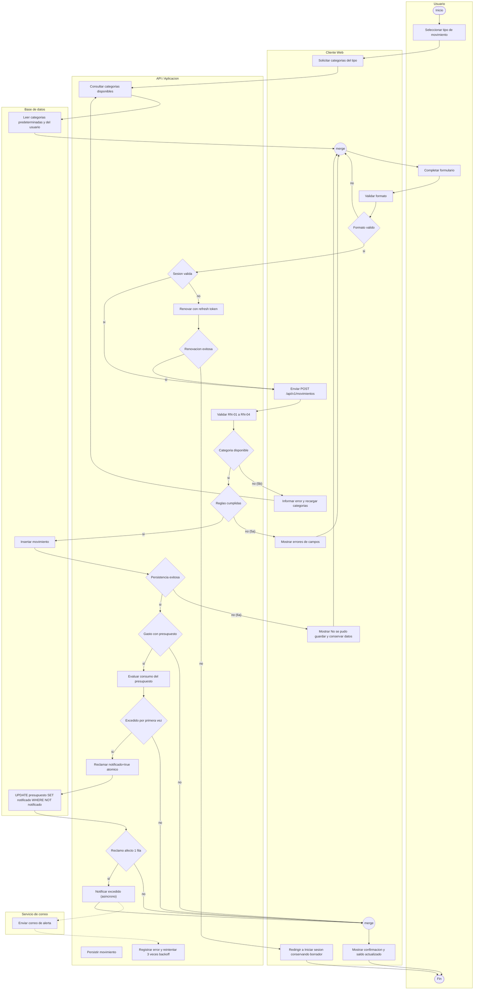

# ACT-01 Registrar movimiento (CU-03)

Fuente: CU-03 flujo básico y alternativos 5a, 5b, 6a, *a (`docs/02-funcional/VISTA_FUNCIONAL.md:40-70,129-158`), RN-01..RN-04, RF-09, RF-11, RF-20.

Renderizado: NO VERIFICADO (no hay mermaid-cli). Mermaid no tiene diagrama de actividad UML: es un `flowchart` con `subgraph` por carril. Convención: rombo `{ }` = nodo de decisión (guardas en las flechas), círculo pequeño `(( ))` = nodo de unión (merge), `([ ])` = inicio/fin. Mermaid ubica los carriles según el motor de layout; el orden visual de carriles no está garantizado.

Notas de lectura:
- El flujo 5b (categoría no disponible) vuelve al paso 2 (`A4`: recarga de categorías). El flujo 5a vuelve al paso 3 (`A6`) vía el merge `M1`. El flujo 6a conserva los datos y vuelve a `A6` vía `M1`.
- La comprobación de sesión (*a) se modela antes del envío; en la práctica ocurre en cualquier paso con una petición HTTP (la guarda `[*a]` se simplifica a un punto).
- La flecha punteada `NOT -.-> MAIL` es asíncrona: la actividad no espera el correo y el gasto no se revierte si falla (A18 es un flujo separado sin retorno al camino principal).

## Cambios respecto al original
- P-09: carriles reales (`subgraph`) en vez de columnas de tabla; se añade el carril **Servicio de correo** y **Notificar** está en el carril API (quien lo solicita), con el envío efectivo en el carril Servicio de correo y no en Base de datos.
- P-09: nodos de decisión (rombos) separados de los de unión (círculos `merge`); el original usaba un mismo nodo para ambos y una barra sin función.
- P-09: se agregan los flujos alternativos 5b (categoría no disponible), 6a (fallo de persistencia) y *a (sesión expirada con renovación y redirección a CU-02), ausentes del original.
- P-19: el reclamo atómico de `notificado` (`UPDATE … WHERE NOT notificado`) precede a la notificación (RN-12).
- Un solo nodo final `Fin` (activity final); el original tenía flujos sin destino claro.
- Supuesto: la rama de error 5b se evalúa en la API al buscar la categoría disponible (coincide con SEQ-01 `CategoriaNoDisponibleException`).
