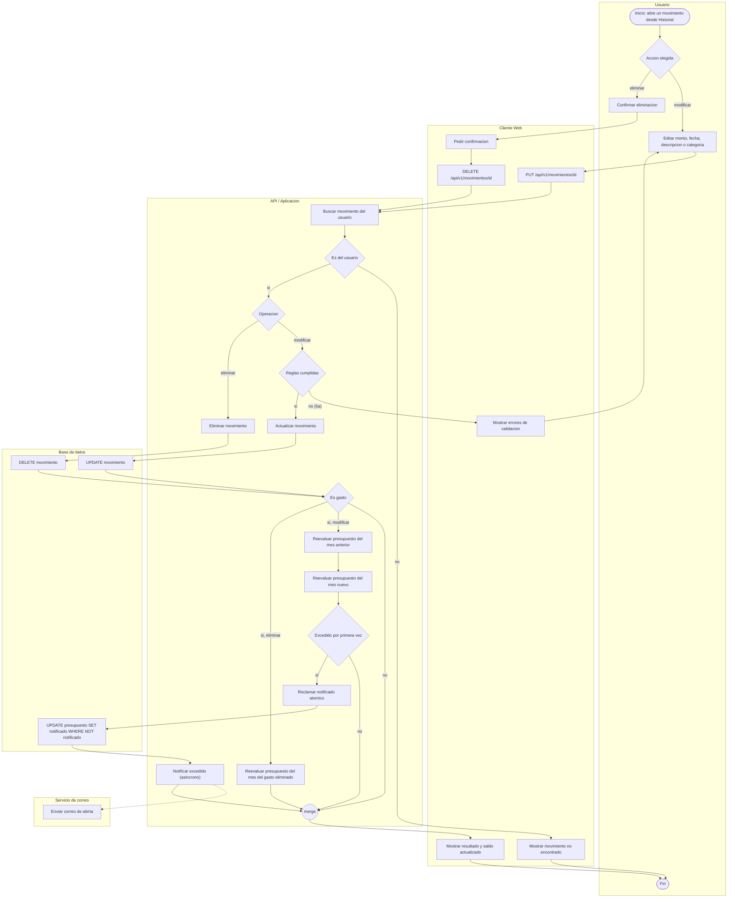

# ACT-02 Modificar o eliminar movimiento (CU-04)

Fuente: CU-04 (catálogo `docs/02-funcional/VISTA_FUNCIONAL.md:22`), RF-12 y RF-13 (`docs/08-requisitos/REQUERIMIENTOS_FUNCIONALES.md:137-152`), RF-20, RN-05, RN-11, RN-12.

Justificación de la elección: CU-04 es el comportamiento con más lógica sin diagrama (P-08) y el que destapa P-10: RF-12 exige reevaluar el presupuesto del mes anterior y del nuevo, algo que el CU-10 original (solo extiende CU-03) no cubre. Aporta además el caso de propiedad ajena (404, RN-05). `VISTA_FUNCIONAL.md` no contiene la especificación textual de CU-04: el flujo de abajo sale de RF-12/RF-13 y `docs/architecture/arquitectura.md:71`; el comportamiento de eliminar frente a presupuesto es una inferencia (**NO VERIFICADO**).

Renderizado: NO VERIFICADO (no hay mermaid-cli). Es un `flowchart` con carriles (`subgraph`); rombos = decisión, círculos = merge.

## Cambios respecto al original
- P-08: aporta un diagrama de comportamiento para CU-04 (antes no existía ninguno).
- P-10: refleja que al modificar un gasto se reevalúa el presupuesto del mes anterior y del nuevo (RF-12), y que CU-10 se dispara también desde CU-04 (ver FUN-01 corregido).
- RN-05 / RNF-02: rama 404 cuando el movimiento no es del usuario.
- P-19: reclamo atómico de `notificado` antes de llamar a `INotificador` (RN-12).
- Supuesto (**NO VERIFICADO**): al eliminar un gasto se reevalúa su mes (RF-13 no lo exige); se incluye por coherencia de saldos y se puede quitar si se rechaza. La reevaluación al eliminar solo puede bajar el consumo, así que no dispara alerta: por eso `REEV3` va directo al merge.
