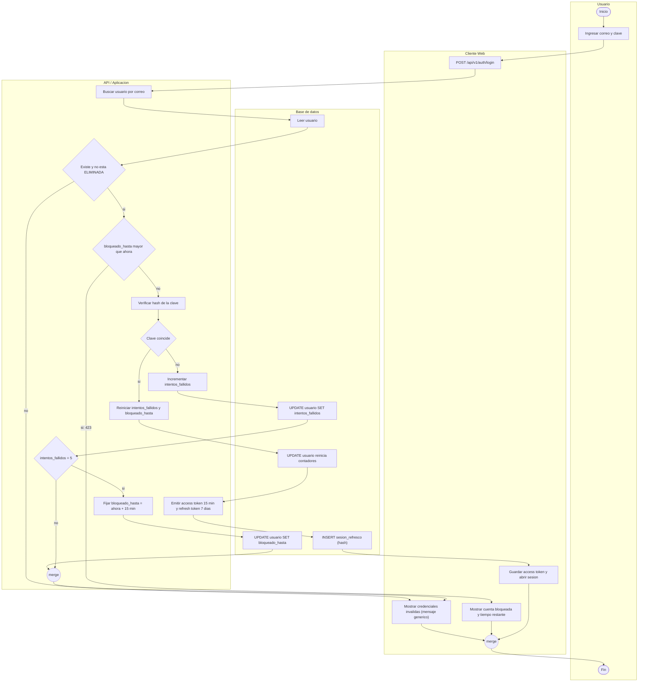

# ACT-03 Iniciar sesión con bloqueo (CU-02)

Fuente: CU-02 (`docs/02-funcional/VISTA_FUNCIONAL.md:105`), RF-03, RF-04, RN-08 (`docs/08-requisitos/REQUERIMIENTOS_FUNCIONALES.md:28,57-72`), arquitectura §4 P-18 y D-4.

Justificación: CU-02 es la segunda lógica con más reglas sin diagrama (P-08): bloqueo a 5 intentos y 15 min (RN-08), 423 con tiempo restante y mensaje genérico anti-enumeración. Complementa a SEQ-03 (mecanismo) con la vista de flujo de decisiones. Se prefiere sobre ACT de CU-09 (recuperar contraseña) porque el bloqueo es un requisito Must (M) y P-13 lo detectó como omisión.

Renderizado: NO VERIFICADO (no hay mermaid-cli). `flowchart` con carriles; rombos = decisión, círculos = merge.

Nota: tras `MGEN` el usuario puede reintentar (volver a `ING`); se omite el ciclo para mantener un solo nodo final. Con cuenta bloqueada, un intento adicional no incrementa el contador (se rechaza antes de verificar la clave).

## Cambios respecto al original
- P-08: aporta el diagrama de comportamiento de CU-02 (el original solo tenía ACT-01, y ACT-02 "Iniciar sesión" estaba solo mencionado, `VISTA_FUNCIONAL.md:158`).
- P-13: incluye comprobación de bloqueo (423) y conteo de intentos (RN-08).
- D-4 / P-18: el bloqueo se deriva de `bloqueado_hasta`, no de un estado `BLOQUEADA` almacenado.
- Mensaje genérico para usuario inexistente, eliminado o clave errónea (CU-02 alternativo).
- Supuesto (**NO VERIFICADO**): el bloqueo se decide al 5.º fallo; RN-08 dice "tras 5 intentos fallidos seguidos" y el CHECK `intentos_fallidos BETWEEN 0 AND 5` lo respalda. Renovar/cerrar sesión (RF-05/06, P-27) quedan fuera de este diagrama.
