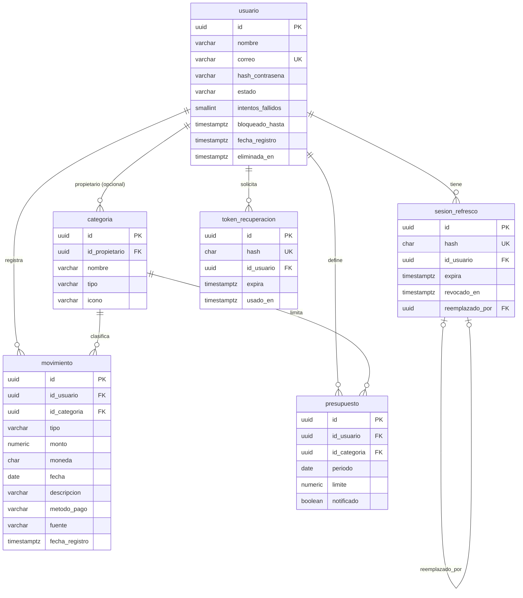

# ER — Modelo de datos objetivo ("después")

> **Histórico (fase de diseño, PostgreSQL).** La aplicación usa MongoDB: el modelo implementado está en [IMP-01_ER_MongoDB.md](IMP-01_ER_MongoDB.md) ([ADR-004](../../architecture/ADR-004-mongodb.md)).

Fuente: `docs/architecture/arquitectura.md` §4 (copia literal del `erDiagram`). Decisiones aplicadas: D-1 (borrado lógico `eliminada_en`, `ON DELETE RESTRICT`), D-4 (`BLOQUEADA` derivado de `bloqueado_hasta`), D-6 (`sesion_refresco`), D-7 (`usado_en`), P-25 (FK `id_<entidad>`).

Renderizado: NO VERIFICADO (no hay mermaid-cli). El "antes" es el modelo de datos de `docs/04-desarrollo/VISTA_DESARROLLO.md:105-120` (sin PNG propio verificado).

## Cambios respecto al original
- P-07 / D-1: `usuario.eliminada_en` y `ON DELETE RESTRICT` en lugar de `ON DELETE CASCADE` (`VISTA_DESARROLLO.md:112-114`).
- P-18 / D-4: bloqueo derivado de `bloqueado_hasta`; se añade `intentos_fallidos` con CHECK 0..5.
- P-16 / D-6 y D-7: tablas `sesion_refresco` y `token_recuperacion` con solo hashes.
- P-25: nombres de FK homogéneos `id_<entidad>`.
- RN-01, RN-03, RN-04, RN-09, RN-10: restricciones listadas en `arquitectura.md` §4 (no se dibujan en el ER).
