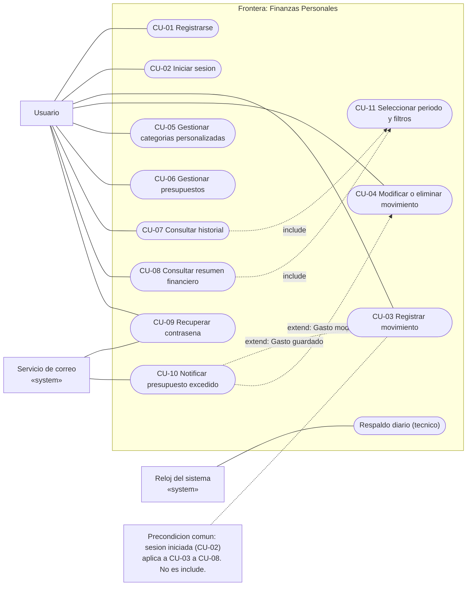

# FUN-01 Casos de uso (versión corregida)

Fuente: `docs/02-funcional/VISTA_FUNCIONAL.md:7-37` (actores y catálogo), RF-12, RF-20 (`docs/08-requisitos/REQUERIMIENTOS_FUNCIONALES.md:141,216`).

Renderizado: NO VERIFICADO (no hay mermaid-cli). **Esto es una aproximación**: Mermaid no tiene diagrama de casos de uso UML. Se usa `flowchart` con actores como rectángulos redondeados, CU como óvalos `([ ])`, asociación como línea simple, `«include»`/`«extend»` como flecha punteada rotulada. Los actores se muestran fuera del subgraph que representa la frontera del sistema.

Notas:
- La nota de precondición se extiende a CU-03, CU-04, CU-05, CU-06, **CU-07** y CU-08 (P-27: el original omitía CU-07). CU-01, CU-02 y CU-09 no la requieren.
- El actor "Reloj del sistema" sí está definido en `VISTA_FUNCIONAL.md:13`. El caso "Respaldo diario" no tiene CU de negocio en el original (se documenta en Despliegue): se dibuja como caso técnico para que el actor no quede aislado. Es una **propuesta**, no un CU del catálogo (**NO VERIFICADO** si el usuario lo acepta).
- Sentido de las flechas según `VISTA_FUNCIONAL.md:35`: `include` del base al incluido; `extend` del que extiende al base.

## Cambios respecto al original
- P-10: CU-10 extiende CU-03 **y** CU-04 (RF-12 y RF-20 exigen reevaluar al modificar un gasto); antes solo CU-03 (`VISTA_FUNCIONAL.md:21,28,94-96`).
- P-11: se dibuja el actor "Reloj del sistema" y el estereotipo de "Servicio de correo" es el mismo (`«system»`, como en `VISTA_FUNCIONAL.md:12`). Pendiente unificar con CTX-01 (`«external system»`, `VISTA_CONTEXTO.md:22`) y DEP (`«device» «external»`, `VISTA_DESPLIEGUE.md:15`): son vistas distintas, pero el nombre del actor debe coincidir (ver CAMBIOS_PENDIENTES_ORIGINALES.md).
- P-27: la precondición incluye CU-07.
- Se mantiene Association (línea simple) actor-CU y la autenticación como precondición, no `include`.
