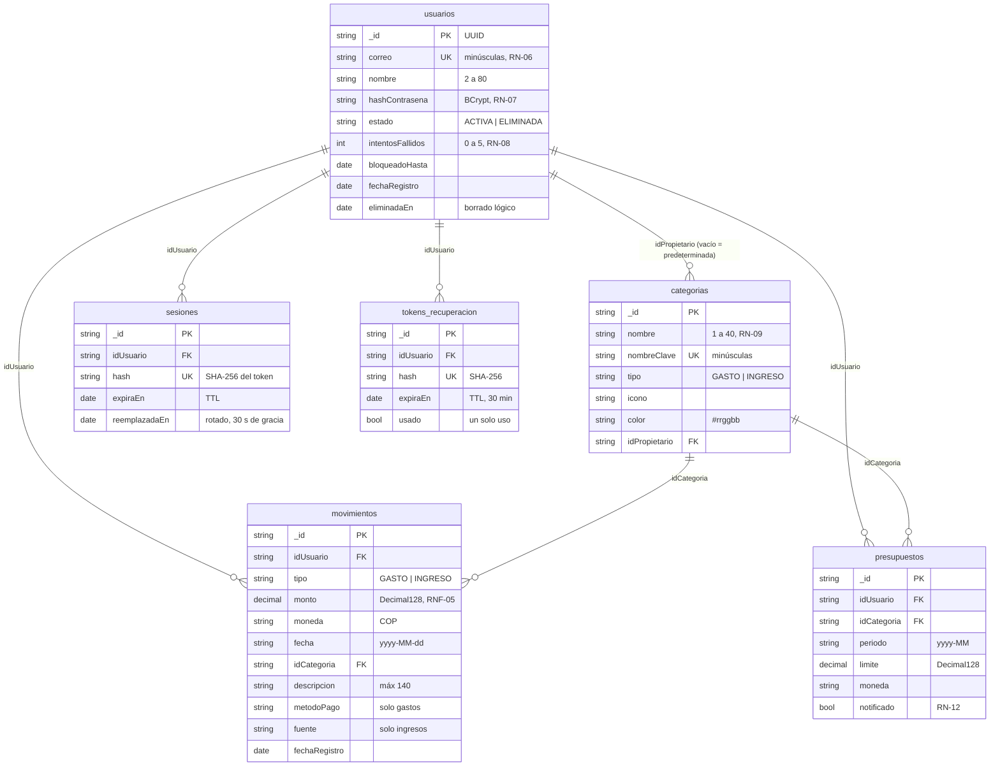

# IMP-01 — Modelo de datos implementado (MongoDB)

Reemplaza al ER relacional de [ER.md](ER.md), que se conserva como histórico de la fase de diseño ([ADR-004](../../architecture/ADR-004-mongodb.md)).

**Fuentes:**
- Campos y reglas: [`base-de-datos/01_colecciones.js`](../../../base-de-datos/01_colecciones.js), que define la validación `$jsonSchema`.
- Índices: [`base-de-datos/02_indices.js`](../../../base-de-datos/02_indices.js).

**Renderizado:** verificado con mermaid y Playwright. La imagen está en [img/IMP-01_ER_MongoDB.svg](img/IMP-01_ER_MongoDB.svg).

Cada colección es un agregado. Las relaciones son referencias por `_id` (UUID en texto), no documentos embebidos. Así, al renombrar o reasignar una categoría (RF-16 y RF-17), todos los movimientos ven el nombre nuevo.

## Índices

| Colección | Índice | Campos | Para qué |
|---|---|---|---|
| usuarios | `uq_usuario_correo` (único) | correo | RN-06: un correo por cuenta |
| categorias | `uq_categoria_nombre` (único) | idPropietario, tipo, nombreClave | RN-09: sin nombres repetidos |
| movimientos | `ix_mov_usuario_fecha` | idUsuario, fecha ↓, fechaRegistro ↓ | Historial paginado |
| movimientos | `ix_mov_usuario_categoria_fecha` | idUsuario, idCategoria, fecha ↓, fechaRegistro ↓ | Filtro por categoría y consumo de presupuestos |
| presupuestos | `uq_presupuesto` (único) | idUsuario, idCategoria, periodo | RN-10: un límite por categoría y mes |
| presupuestos | `ix_presupuesto_periodo` | idUsuario, periodo | Presupuestos del mes |
| sesiones | `uq_sesion_hash`, `ix_sesion_usuario`, `ttl_sesion` | hash / idUsuario / expiraEn | Renovar, cerrar todas, caducidad automática |
| tokens_recuperacion | `uq_recuperacion_hash`, `ttl_recuperacion` | hash / expiraEn | Enlace de un solo uso que caduca solo |
