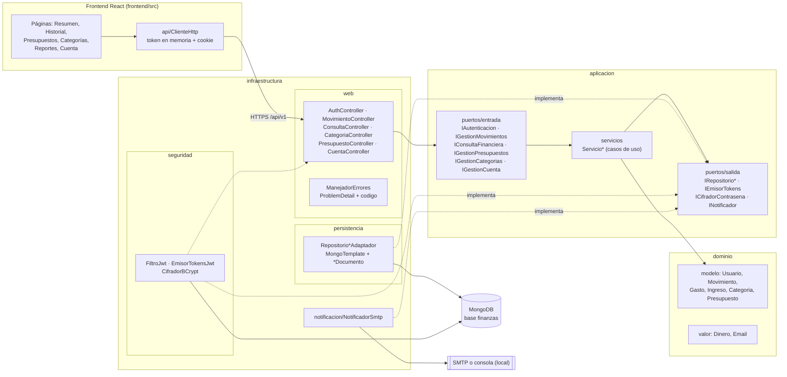

# IMP-02 — Componentes del backend (arquitectura hexagonal implementada)

**Fuente:** el código en `backend/src/main/java/co/finanzas/`, con los nombres reales de paquetes, puertos y clases.

**Renderizado:** verificado. La imagen está en [img/IMP-02_Componentes_hexagonal.svg](img/IMP-02_Componentes_hexagonal.svg).

**Regla de dependencias:** apuntan siempre hacia el dominio. Las comprueba en cada `mvn test` la prueba de ArchUnit `ArquitecturaTest` (4 reglas).

