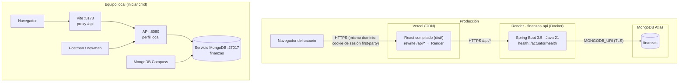

# IMP-03 — Despliegue (producción y entorno local)

**Fuentes:**
- [`frontend/vercel.json`](../../../frontend/vercel.json): reescritura de `/api` y cabeceras de seguridad.
- [`render.yaml`](../../../render.yaml): servicio `finanzas-api`, plan gratuito, con comprobación de salud en `/actuator/health`.
- [`iniciar.cmd`](../../../iniciar.cmd): arranque local.

**Renderizado:** verificado. La imagen está en [img/IMP-03_Despliegue.svg](img/IMP-03_Despliegue.svg).

Que el sitio publicado funcione con esta versión es **NO VERIFICADO**; el detalle está en la sección 0 del [informe final](../../INFORME_FINAL.md).

| Variable (Render) | Uso |
|---|---|
| `MONGODB_URI` | Cadena de MongoDB Atlas con el nombre de la base |
| `JWT_SECRET` | Firma de los tokens, mínimo 32 caracteres |
| `FRONTEND_URL` | Enlaces de recuperación de contraseña |
| `CORS_ORIGINS` | Dominio de Vercel |
| `COOKIE_SECURE`, `COOKIE_SAMESITE` | Cookie de sesión `Secure` y `Lax`, porque es del mismo sitio gracias a la reescritura |
| `MAIL_FROM` (+ `SPRING_MAIL_*`) | Remitente y servidor de correo |
