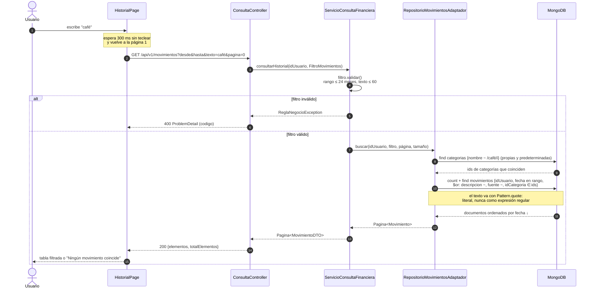

# IMP-04 — Secuencia: buscar en el historial (HU-16 y HU-17)

**Fuente:** las clases y métodos del código:
- `HistorialPage.tsx` (300 ms de espera antes de buscar)
- `ConsultaController.historial`
- `ServicioConsultaFinanciera.consultarHistorial`
- `RepositorioMovimientosAdaptador.buscar` y `coincideTexto`

**Renderizado:** verificado. La imagen está en [img/IMP-04_SEQ_Buscar_historial.svg](img/IMP-04_SEQ_Buscar_historial.svg).

**Pruebas que la cubren:** `ApiIntegracionTest` (5 casos de texto), Postman "Buscar en el historial por texto" y Playwright "HU-17 búsqueda".

