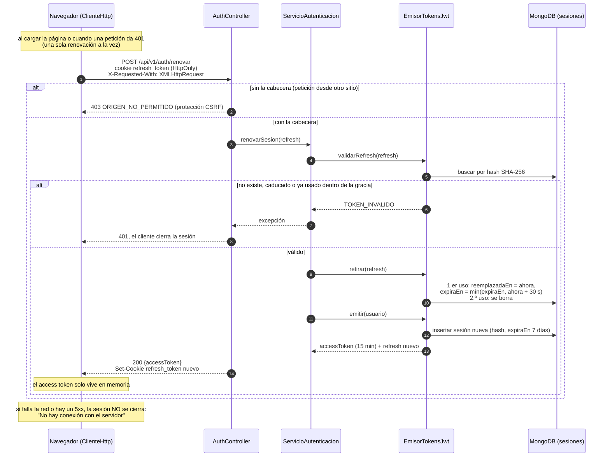

# IMP-05 — Secuencia: renovar la sesión (HU-03, RF-05)

**Fuente:** las clases y métodos del código:
- `ClienteHttp.renovarConResultado`
- `AuthController.renovar` y `exigirPeticionDeLaApp`
- `ServicioAutenticacion.renovarSesion`
- `EmisorTokensJwt.retirar` y `GRACIA_ROTACION`

**Renderizado:** verificado. La imagen está en [img/IMP-05_SEQ_Renovar_sesion.svg](img/IMP-05_SEQ_Renovar_sesion.svg).

**Pruebas que la cubren:**
- `ApiIntegracionTest`: 403 sin cabecera; con el token rotado, 200 una vez y después 401.
- Postman: carpeta 1.
- Playwright: "HU-03 sesión".

Los 30 s de gracia evitan que dos pestañas que renuevan a la vez se cierren la sesión entre sí. El token anterior sirve una sola vez más dentro de esa ventana.
