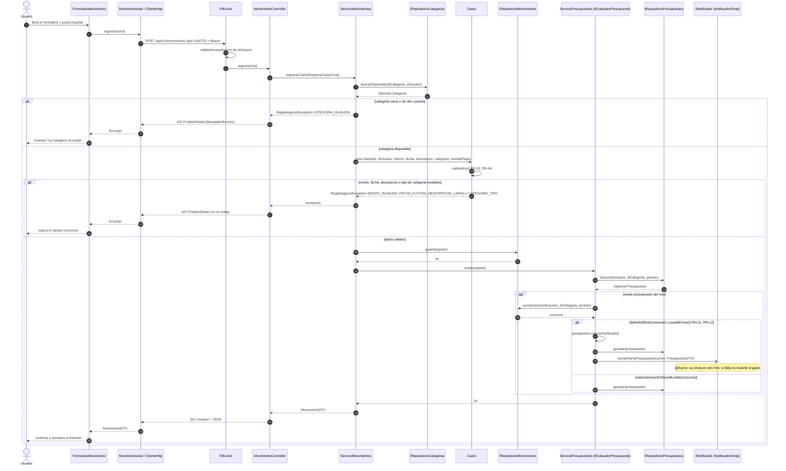

# SEQ-01 Registrar gasto (CU-03 + CU-10)

Fuente: CU-03 y CU-10 (`docs/02-funcional/VISTA_FUNCIONAL.md:160-186`), RF-09, RF-11, RF-20, RN-01..RN-04, RN-11, RN-12. Alineado el 22-11-2026 con el código:

- `FormularioMovimiento.tsx` y `MovimientosApi.ts`;
- `FiltroJwt`, `MovimientoController`, `ServicioMovimientos.registrarGasto` y `Movimiento.validar`;
- `ServicioPresupuestos.evaluar`, `NotificadorSmtp` (`@Async`) y `ManejadorErrores`.

Sintaxis validada con `mermaid.parse` ([log](../pruebas/mermaid-arquitectura.log)).

## Correcciones (22-11-2026, contra el código)

- **Excepciones:** `CategoriaNoDisponibleException` y `ValidacionException` no existen. El código lanza `ReglaNegocioException` con un código (`CATEGORIA_INVALIDA`, `MONTO_INVALIDO`, `FECHA_FUTURA`, `DESCRIPCION_LARGA`, `CATEGORIA_TIPO`), y `ManejadorErrores` lo convierte en `422` con `ProblemDetail`.
- **Participante del frontend:** `ClienteWeb` no existe. El participante real es `FormularioMovimiento`, que llama a `MovimientosApi.registrar`, que a su vez pasa por `ClienteHttp`. El mensaje `confirmarFormulario` tampoco existe.
- **Autenticación:** el `idUsuario` lo obtiene `FiltroJwt.validarAcceso(token)` antes de llegar al controlador.
- **Respuesta:** es `201 Created` con el JSON del movimiento. El código no envía cabecera `Location`.
- **Aviso de presupuesto:**
  - no hay `UPDATE … WHERE NOT notificado` ni transacción explícita (no hay `@Transactional`);
  - el servicio llama a `marcarNotificado()` y a `guardar(presupuesto)`;
  - la regla de "solo la primera vez" está en `debeNotificar(consumo)`, que mira el campo `notificado`;
  - el aviso se reinicia con `reiniciarAvisoSiVolvioAlLimite`.
- **Envío del correo:** es asíncrono porque `NotificadorSmtp` está anotado con `@Async`; no se debe a que vaya "después del commit".
- **Rama quitada:** la de "fallo de persistencia → 500" ya no está como flujo propio. Un error inesperado lo maneja `ManejadorErrores.inesperado`, que responde 500 de forma genérica.
