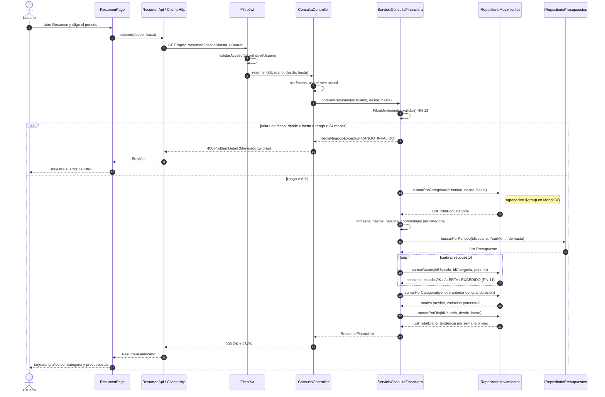

# SEQ-02 Consultar resumen financiero (CU-08, incluye CU-11)

Fuente: CU-08 (`docs/02-funcional/VISTA_FUNCIONAL.md:87-92,188-192`), RF-19, RF-23/24, RN-11, RN-13. Alineado el 22-11-2026 con el código:

- `ResumenPage.tsx` y `ResumenApi.ts`;
- `ConsultaController.resumen`;
- `ServicioConsultaFinanciera.obtenerResumen` y `FiltroMovimientos.validar`.

Sintaxis validada con `mermaid.parse` ([log](../pruebas/mermaid-arquitectura.log)).

## Correcciones (22-11-2026, contra el código)

- **Excepción y código HTTP:** `RangoInvalidoException` no existe. El código lanza `ReglaNegocioException("RANGO_INVALIDO")` desde `FiltroMovimientos.validar()`, y `ManejadorErrores` lo asigna a **400**, no a 422.
- **Participante del frontend:** `ClienteWeb` no existe. Los participantes reales son `ResumenPage` y `ResumenApi.obtener`, que pasan por `ClienteHttp`. El `idUsuario` lo obtiene `FiltroJwt`.
- **Fechas por defecto:** si no llegan fechas, el controlador usa el mes actual.
- **Lo que el resumen calcula de verdad,** y que faltaba en el diagrama:
  - el consumo de cada presupuesto (`sumarGastos`);
  - la variación frente al periodo anterior (segundo `sumarPorCategoria`);
  - la tendencia (`sumarPorDia`).
- **Periodo de los presupuestos:** se toma de `hasta` (`YearMonth.from(hasta)`), no de `desde`.
