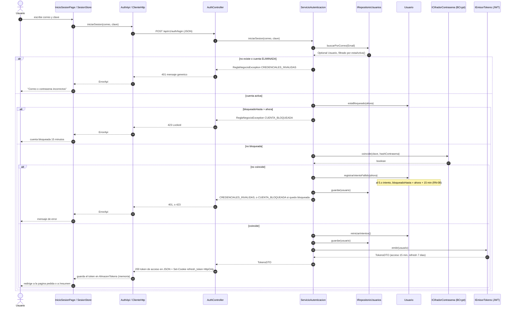

# SEQ-03 Iniciar sesión (CU-02)

Fuente: CU-02 (`docs/02-funcional/VISTA_FUNCIONAL.md:105,194-198`), RF-03, RF-04, RN-08 (`docs/08-requisitos/REQUERIMIENTOS_FUNCIONALES.md:28,57-72`). Alineado el 22-11-2026 con el código:

- `InicioSesionPage.tsx`, `SesionStore.tsx` y `AuthApi.ts`;
- `AuthController.iniciarSesion` y `CookieSesion`;
- `ServicioAutenticacion.iniciarSesion` y `buscarActivo`;
- `Usuario.estaBloqueado`, `registrarIntentoFallido` y `reiniciarIntentos`.

Sintaxis validada con `mermaid.parse` ([log](../pruebas/mermaid-arquitectura.log)).

## Correcciones (22-11-2026, contra el código)

- **Excepciones:** `CredencialesInvalidasException` y `CuentaBloqueadaException` no existen. El código lanza `ReglaNegocioException` con los códigos `CREDENCIALES_INVALIDAS` (401) y `CUENTA_BLOQUEADA` (423), definidos en `ManejadorErrores`.
- **Participante del frontend:** `ClienteWeb` no existe. Los participantes reales son `InicioSesionPage`, `SesionStore` y `AuthApi.iniciarSesion`. El token de acceso se guarda en memoria (`AlmacenTokens`).
- **Contador y bloqueo:** no hay "UPDATE atómico" en el repositorio. Las reglas de bloqueo viven en la entidad `Usuario`:
  - `estaBloqueado(ahora)`;
  - `registrarIntentoFallido(ahora)`, que bloquea al 5.º fallo;
  - `reiniciarIntentos()`.

  Después, el servicio llama a `guardar(usuario)`. Así se resuelve el antiguo supuesto sobre `IRepositorioUsuarios`.
- **Cuentas eliminadas:** `buscarActivo` filtra con `estaActiva()`, de modo que una cuenta `ELIMINADA` responde igual que un correo inexistente (401 genérico). Esto ya está verificado en el código.
- **Fallo que bloquea:** si el fallo que se acaba de registrar deja la cuenta bloqueada, la respuesta es **423** y no 401.
